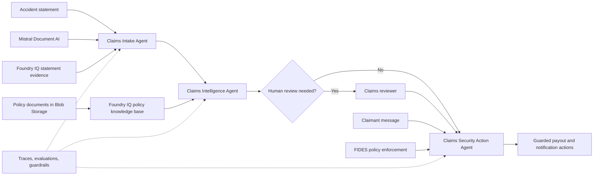
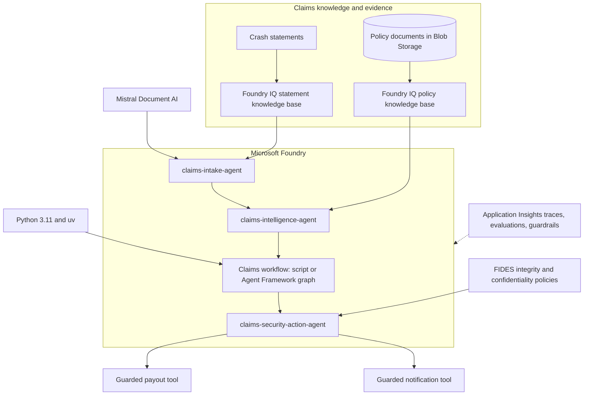

# Agentic AI Hacks | Claims Intelligence

## Standalone repository

This repository contains only the Claims Processing workshop from
[Microsoft MicroHack](https://github.com/microsoft/MicroHack), exported from
commit `f0b37bf3f99d231512a2232480aca133c287a551` of the working MicroHack repository.
The upstream Microsoft copyright and [MIT license](./LICENSE) are retained.

The **workshop root** is the root of this cloned repository: the folder containing
`pyproject.toml`, `azure.yaml`, `docs/`, and `agent-framework/`. Unless a step says
otherwise, run workshop commands from that folder.

> ⚠️ **This repository is under construction.** All information found here is a work in progress and is likely to change at any time without prior notice.

> 📚 **[Browse the ClaimSight workshop guide](./docs/index.md)** for the challenge
> roadmap and setup. To preview the full searchable MkDocs site with synchronized
> Bash/zsh and PowerShell tabs, follow the [local preview guide](./docs/contributing.md).

## Introduction

Insurance claims teams must turn unstructured accident statements, policy documents,
and claimant messages into timely, defensible decisions. Manual handoffs slow that
work, while ungrounded automation can overlook policy constraints or allow untrusted
content to influence sensitive actions.

ClaimSight is an **agentic claims intelligence system** that converts scanned accident
statements into structured claim data, retrieves enterprise statement and policy
evidence through Foundry IQ, coordinates specialized agents, and protects downstream
actions from prompt injection and data exfiltration. The workflow uses **Mistral
Document AI**, **Foundry IQ**, **Microsoft Foundry agents**, the **Microsoft Agent
Framework**, and **FIDES**.

During this microhack, you will build a reusable Python workflow that progresses from
document intake to policy-grounded adjudication, conditional human review, deterministic
security enforcement, and protected downstream actions. You will then explore production
readiness by tracing the agents, evaluating decisions, and adding guardrails. These exercises
demonstrate controls, not a production certification; preview features, operational reliability,
privacy, and access policies still need validation for your workload.

---

## Scenario

An accident statement enters the claims system. The ClaimSight workflow must:

1. Use the **Claims Intake Agent** to extract claim details with Mistral Document AI
	 and retrieve related statement evidence through Foundry IQ.
2. Use the **Claims Intelligence Agent** application component to retrieve the matching
	 policy from a Foundry IQ knowledge base, structure its coverage rules, and produce
	 an evidence-backed decision.
3. Coordinate the intake and intelligence agents in sequence,
	 routing uncertain or escalated decisions to human review.
4. Use the **Claims Security Action Agent** and FIDES to prevent untrusted claimant
	 content from authorizing payouts or exposing private policyholder data.
5. Trace each claim, evaluate the decisions with rubric and continuous evaluations, and
	 measure a guardrail so quality and safety stay visible after release.

The following diagram shows the claim journey and the responsibilities introduced by
the challenges:



Challenge 5 introduces observability with hands-on evaluation and guardrail tests focused
on the intelligence agent. Challenge 6 then adds deterministic FIDES controls around
downstream actions. These exercises do not automatically instrument all agents or provide
one end-to-end workflow trace.

---

## Architecture

The microhack builds a Python-based, multi-agent claims system. Microsoft Foundry
hosts the specialized agents. Foundry IQ supplies grounded statement evidence and
retrieves policy documents from Azure Blob Storage through a dedicated knowledge base.
The Microsoft Agent Framework coordinates the workflow and applies FIDES controls
before privileged tools run.



### The three agents

| Agent                        | Role                                                           | Data source or control                       | Introduced in |
|------------------------------|----------------------------------------------------------------|----------------------------------------------|---------------|
| Claims Intake Agent          | Extracts claim details and retrieves related statement context | Mistral Document AI and Foundry IQ           | Challenge 2   |
| Claims Intelligence Agent    | Retrieves policy data and evaluates coverage, consistency, and escalation | Foundry IQ policies knowledge base | Challenge 3   |
| Claims Security Action Agent | Attempts downstream actions within deterministic trust limits  | FIDES integrity and confidentiality policies | Challenge 6   |

---

## Learning objectives

By participating in this microhack, you will learn how to:

* Build a Microsoft Foundry agent that combines document extraction with grounded
	retrieval through Foundry IQ
* Create a Foundry IQ knowledge base over policy documents in Azure Blob Storage
* Convert retrieved policy documents into typed data for coverage adjudication
* Compose intake and intelligence agents into a sequential workflow with conditional
	human review
* Build the same workflow with Microsoft Agent Framework executors and edges, and deploy it
	as a hosted Foundry agent
* Apply FIDES integrity and confidentiality policies to sensitive tools
* Test prompt-injection and private-data exfiltration defenses
* Trace agent runs, score decisions with rubric and continuous evaluations, and measure
	guardrails before and after you change them

---

## Requirements

To complete the microhack, you will need:

* A [GitHub account](https://github.com/signup) and access to the repository
* Familiarity with Python, JSON, command-line tools, and generative AI concepts
* Python 3.11 and [uv](https://docs.astral.sh/uv/)
* Azure CLI authenticated with the event account used for the lab
* Azure resources and environment values supplied by the MicroHack platform or your
	event coach
* For Challenge 5: permission to connect Application Insights to the Foundry project and
	to create guardrails (the challenge lists the exact roles)
* For Challenge 6: the FIDES dependency versions and Foundry access described in the challenge

### Participant setup

Run setup commands from the root of the cloned repository, the folder containing
`pyproject.toml`, `azure.yaml`, `docs/`, and `agent-framework/`. If your terminal is
elsewhere, open this cloned repository folder in your editor or terminal first.

Complete all environment preparation in
[Challenge 1: Prepare the Environment](./challenges/challenge-01.md). It covers the
Codespaces setup, dependency installation, Azure authentication, local configuration,
and validation required before beginning the build challenges.

---

## Repository structure

```text
<cloned-repository>/
|-- agent-framework/            # Default Challenge 4 workflow and hosted-agent container
|-- challenges/                 # Challenge instructions (challenge-01 through challenge-06)
|-- data/
|   |-- claims/                 # Raw and derived sample claim evidence
|   |-- evaluation/             # Labeled test set and rubric for Challenge 5
|   `-- policies/               # Sample insurance policy documents
|-- docs/                       # Python agents, workflows, and evaluation scripts
|-- labautomation/              # MicroHack provisioning and Azure deployment template
|-- walkthrough/                # Reference solutions for each challenge
|-- azure.yaml                  # Hosted agent definition for azd and the Foundry Toolkit
|-- pyproject.toml              # Pinned participant environment
`-- README.md
```

| Path                                   | Who uses it                | Purpose                                                     |
|----------------------------------------|----------------------------|-------------------------------------------------------------|
| [`challenges/`](./challenges/)         | Attendees                  | Step-by-step instructions for the six challenges            |
| [`agent-framework/`](./agent-framework/) | Attendees                | Default Challenge 4 Agent Framework workflow and container |
| [`data/`](./data/)                     | Attendees and scripts      | Accident evidence and policy documents used by the workflow |
| [`docs/`](./docs/)                     | Attendees                  | Supplied Python agents and orchestration code               |
| [`labautomation/`](./labautomation/)   | Platform and coaches       | Per-lab provisioning and Azure Resource Manager deployment  |
| [`walkthrough/`](./walkthrough/)       | Facilitators and attendees | Reference solutions for each challenge                     |

---

## Challenges

The microhack contains one preparation challenge and five core build challenges. Each
build stage extends the same end-to-end claims workflow.

### Challenge structure

Each challenge follows a consistent learning path:

| Section              | Description                                             |
|----------------------|---------------------------------------------------------|
| Overview             | Scenario, intended outcome, and key concepts            |
| Prerequisites        | Required resources and completed earlier work           |
| Tasks                | Commands and guided steps for the challenge             |
| Expected output      | Results and artifacts used to verify the implementation |
| Validation checklist | Completion criteria                                     |
| Next step            | Transition to the next stage of the claims workflow     |

### Challenge list

Joining directly at Challenge 4? Follow the
[direct-start prerequisites and local setup](./challenges/challenge-04-agent-framework.md#starting-directly-at-challenge-4)
to restore what Challenges 1-3 would have prepared.

| # | Challenge | Description | Duration |
|---|-----------|-------------|----------|
| 1 | [Prepare the Environment](./challenges/challenge-01.md) | Verify access to the provisioned Azure resources and development environment used throughout the microhack | 30 min |
| 2 | [Build the Claims Intake Agent](./challenges/challenge-02.md) | Process accident statements with Mistral Document AI and ground the structured intake in Foundry IQ evidence | 45 min |
| 3 | [Build the Claims Intelligence Agent](./challenges/challenge-03.md) | Ground one intelligence agent in a Foundry IQ policy knowledge base and produce an auditable coverage decision | 30 min |
| 4 | [Build the Claims Workflow with Agent Framework](./challenges/challenge-04-agent-framework.md) | Default path: compose intake and intelligence agents as a graph with conditional human review and optional hosted-agent deployment. The [manual sequential workflow](./challenges/challenge-04.md) remains an alternative | 45 min |
| 5 | [Observe, Evaluate, and Guard the Claims Workflow](./challenges/challenge-05.md) | Trace agent calls, score decisions with rubric and continuous evaluations, and measure a guardrail | 90 min |
| 6 | [Harden the Claims Pipeline Against Prompt Injection](./challenges/challenge-06.md) | Apply FIDES controls to block unauthorized payout and private-data exfiltration attempts | 60 min |

> [!TIP]
> Pause after each challenge to consider where the same patterns apply in your own
> business processes. Grounded retrieval, specialized agent orchestration, explicit
> human review, deterministic tool controls, and continuous evaluation extend beyond
> insurance claims.

### Solution walkthroughs

* [Challenge 2 solution](./walkthrough/challenge-02/solution-02.md)
* [Challenge 3 solution](./walkthrough/challenge-03/solution-03.md)
* [Challenge 4 solution (Agent Framework, default)](./walkthrough/challenge-04/solution-04-agent-framework.md)
* [Challenge 4 solution (manual sequential alternative)](./walkthrough/challenge-04/solution-04.md)
* [Challenge 5 solution](./walkthrough/challenge-05/solution-05.md)
* [Challenge 6 solution](./walkthrough/challenge-06/solution-06.md)

---

## Contributing

This project welcomes contributions and suggestions. Most contributions require you to
agree to a Contributor License Agreement (CLA) declaring that you have the right to,
and do, grant us the rights to use your contribution. For details, visit the
[Microsoft CLA website](https://cla.opensource.microsoft.com/).

This project has adopted the
[Microsoft Open Source Code of Conduct](https://opensource.microsoft.com/codeofconduct/).
For more information, see the
[Code of Conduct FAQ](https://opensource.microsoft.com/codeofconduct/faq/) or contact
[opencode@microsoft.com](mailto:opencode@microsoft.com).

## Trademarks

This project may contain trademarks or logos for projects, products, or services.
Authorized use of Microsoft trademarks or logos is subject to the
[Microsoft Trademark and Brand Guidelines](https://www.microsoft.com/legal/intellectualproperty/trademarks/usage/general).
Use of Microsoft trademarks or logos in modified versions of this project must not
cause confusion or imply Microsoft sponsorship. Any use of third-party trademarks or
logos is subject to those third parties' policies.
