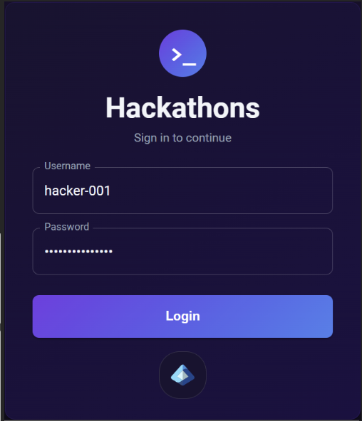
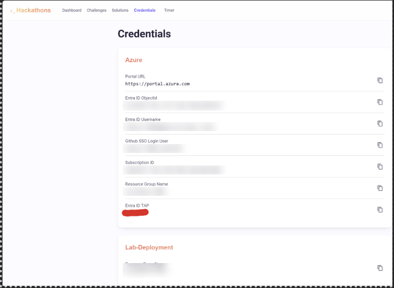
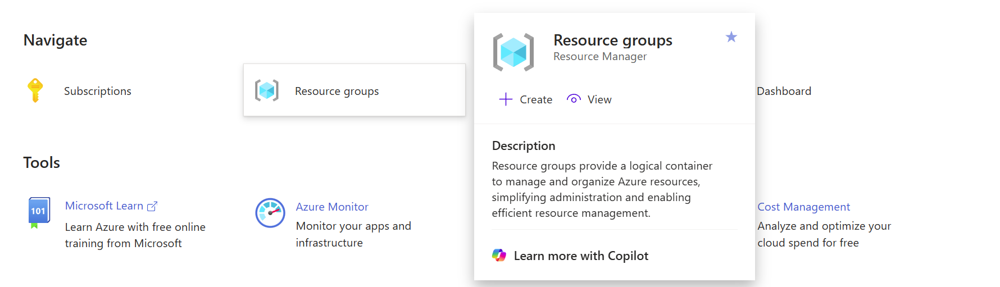
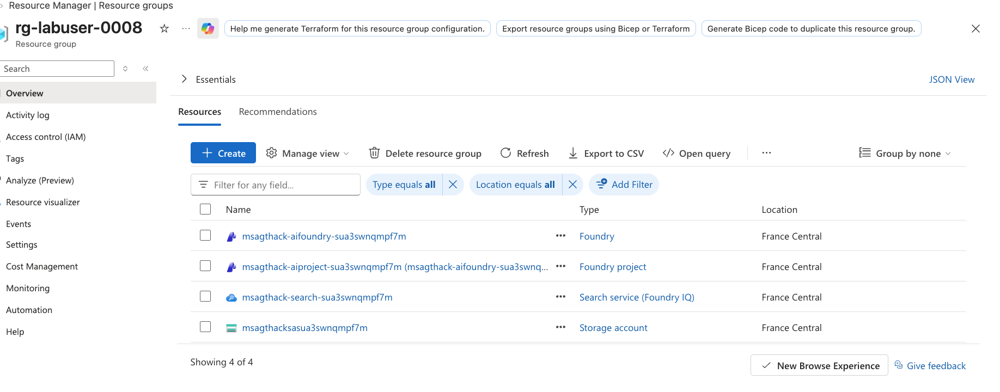
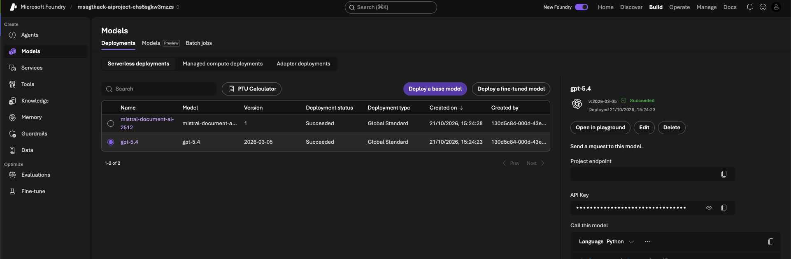
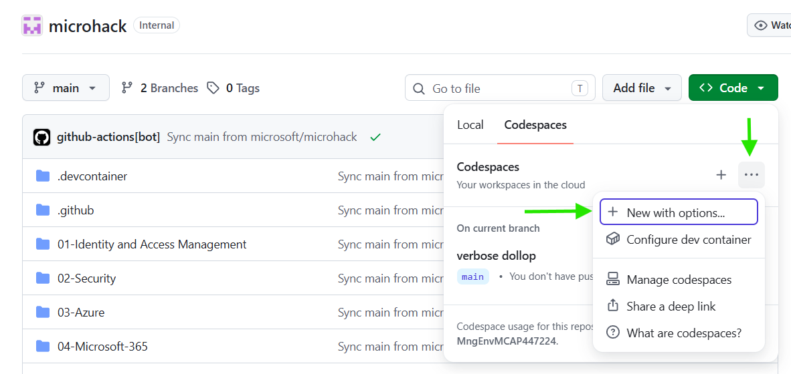

# Challenge 1 - Prepare the Environment

**[Home](../README.md)** | [Next challenge](challenge-02.md)

## 🎯 Objective

Sign in with your assigned lab credentials, verify the pre-provisioned Azure resources, and start the GitHub Codespaces development environment used throughout the Claims Intelligence MicroHack.

## 🧭 Context and Background

The remaining challenges use a pre-provisioned Azure environment and a repository hosted on GitHub. You will work from a GitHub Codespace configured with the tools and dependencies required to build the claims intelligence solution.

Complete this setup with the credentials provided in your Hackbox. Use the assigned lab account for the Azure portal and the event console so that you have access to the correct Azure subscription and resource group. For the GitHub Codespace, use your own GitHub account.

## 🔑 Get your event access

Before you start the tasks, sign in to the event console at
**[emea.microhack.cloud](https://emea.microhack.cloud/)** and find your Azure lab
credentials. Your event lead provides a username and password for the console.
Use them only during the event window your event lead set.

1. Open [emea.microhack.cloud](https://emea.microhack.cloud/).
2. Sign in with your username and password. 
3. On the home screen, open **Credentials**. You see only your own Azure lab
   credentials. Keep them ready for the tasks below.

The sign-in screen from step 2:



The **Credentials** dashboard from step 4 lists your own Azure lab details. The Entra ID TAP is hidden in this example:



> [!IMPORTANT]
> The console sign-in is different from your Azure credentials. Use each one only where
> a step asks for it. Do not share them, paste them into chat or issues, or capture them
> in a screenshot.

## ✅ Tasks

### 1. Sign in to Azure

Open the [Azure portal](https://portal.azure.com) and sign in with the credentials provided in your Hackbox.

When prompted to choose an account, select **Use another account** and input the credentials provided. Do not use your personal or work account.


In the Azure portal, select **Resource groups** from the navigation menu.



Open the resource group assigned to you and confirm that its resources have been deployed successfully.



#### Verify access to the resources used in later challenges

Check each resource below in the portal. You only need to open and read them. Do not change any settings.

**a. Microsoft Foundry project and model deployments**

1. Open [ai.azure.com](https://ai.azure.com) and sign in with the lab account.
2. Use the project selector at the top of the page to select the Foundry project in your resource group.
3. Make sure the **New Foundry** toggle in the top bar is on.
4. Select **Build** > **Models**. On the **Deployments** tab, select **Serverless deployments** and confirm these two deployments exist with **Deployment status** set to **Succeeded**:
   - `gpt-5.4` (Model `gpt-5.4`, Deployment type **Global Standard**)
   - `mistral-document-ai-2512` (Model `mistral-document-ai-2512`, Version `1`)



5. Select **Manage** > **Project details** > **Connected resources**. Confirm that the Azure AI Search connection is listed. The Storage account connection is optional at this stage.

Do not copy the API key shown on the model page. The setup script in step 3 retrieves the keys for you.

**b. Azure AI Search service**

1. In the [Azure portal](https://portal.azure.com), open the resource group and select the **Azure AI Search** service.
2. On the **Overview** page, confirm that the service loads without errors.
3. Under **Search management**, select **Indexes**. The `crash-statements` index is created in Challenge 2, so it may not be listed yet. That is expected.
4. Under **Agentic retrieval**, confirm that the page opens without errors.

**c. Storage account**

1. In the Azure portal, open the resource group and select the **Storage account**.
2. On the **Overview** page, confirm that the account loads without errors.
3. Select **Data storage** > **Containers**. Confirm that the `claims-data` and `policies` containers are listed. Step 4 below checks the file counts.

When all three checks pass, continue to the next step.

### 2. Get the repository

The workshop code is in the GitHub repository **[pankajagrawal16/claims-processing](https://github.com/pankajagrawal16/claims-processing)**. Choose one option:

- **Option A: GitHub Codespace (recommended).** Create a Codespace from your own GitHub account. The repository's **Claims Hack** dev container sets up the tools for you. Follow step 3.
- **Option B: Clone to your computer.** Use your own editor and terminal. Follow *2B*, then continue with step 3 from your terminal.

**2B. Clone the repository**

Use this option if you prefer a local environment. First install [Git](https://git-scm.com/downloads), the [Azure CLI](https://learn.microsoft.com/cli/azure/install-azure-cli), [Python 3.11](https://www.python.org/downloads/), and [uv](https://docs.astral.sh/uv/getting-started/installation/). Then run these commands in a terminal, in the folder where you want the project:

```bash
git clone https://github.com/pankajagrawal16/claims-processing.git
cd claims-processing
```

These commands are the same in PowerShell. If GitHub asks you to sign in, use the lab account. Continue with step 3 from the cloned `claims-processing` folder.

### 3. Create the development environment

**Option A (Codespace):** open [pankajagrawal16/claims-processing](https://github.com/pankajagrawal16/claims-processing) while signed in to your own GitHub account, select **Code**, then open the **Codespaces** tab. Select the `...` menu and choose **New with options**.



For **Dev container configuration**, select **Claims Hack**, then select **Create codespace**.

GitHub opens the Codespace in a new browser tab. Wait for the container setup to finish, then confirm that the repository files are visible in the Explorer and that the integrated terminal opens without errors.

Open a terminal in the Codespace (Terminal > New Terminal) and run the following command to verify that the required tools are installed:

```bash
az --version
```

Run the remaining commands from the **root of the cloned repository** (the folder
containing `pyproject.toml` and `azure.yaml`). If needed, open that folder in your
editor or terminal. Install the pinned project dependencies and activate the
environment:

=== "Bash/zsh"

    ```bash
    uv sync --refresh --python 3.11 --default-index https://pypi.org/simple
    source .venv/bin/activate
    ```

=== "PowerShell"

    ```powershell
    uv sync --refresh --python 3.11 --default-index https://pypi.org/simple
    .\.venv\Scripts\Activate.ps1
    ```

Sign in to Azure from the Codespace terminal with the assigned lab account:

```console
az login --use-device-code
```

From the same workshop folder, run the setup script with the resource group name provided
in your Hackbox. Use the script for your shell:

=== "Bash/zsh"

    ```bash
    bash labautomation/get-keys.sh --resource-group "<your-resource-group-name>"
    ```

    This script needs Bash 4 or newer. macOS's built-in Bash 3.2 is too old; use the
    Codespace or a newer Bash.

=== "PowerShell"

    ```powershell
    .\labautomation\get-keys.ps1 -ResourceGroup "<your-resource-group-name>"
    ```

    This runs on Windows PowerShell or PowerShell 7 with no WSL or Git Bash needed.
    Azure CLI must be installed.

The script locates the latest successful Claims MicroHack deployment and creates a
local `.env` file in the repository root. It retrieves the Foundry project endpoint,
Mistral Document AI key and endpoint, Azure AI Search key and endpoint, and Storage
connection string required by Challenges 2 through 6. The file is excluded from Git,
written with permissions `600`, and its secret values are not displayed.

??? tip "💡 Why did I run this step?"

    **What the script does.** The lab deployment already created the Foundry project, Azure AI Search
    service, Mistral Document AI deployment, and Storage account. The script reads the outputs of that
    deployment and writes the endpoints and keys to a local `.env` file.

    **Why this matters.** Every Python command in Challenges 2 to 6 reads its settings from `.env`. The code
    never contains an endpoint or a key, so you can share the repository without leaking credentials.

    **Why the file is locked down.** `.env` is excluded from Git and readable only by your user. The
    script never prints the secrets. When you check that a value exists, check it by name, not by printing it.

    **Why you may need to run it again.** If the deployment changes, rerun the script. Afterward, restore any
    optional settings you added, such as the Application Insights connection string in Challenge 5.

### 4. Verify the Blob Storage assets

??? tip "💡 Why did I run this step?"

    **What you are checking.** The lab stores its raw input data in Azure Blob Storage, in two containers:

    - **`claims-data`** holds the 17 claim files for the five crashes. Each crash folder has
      `raw/statements` (the driver statement images) and `raw/vehicle-damage` (the damage photos).
    - **`policies`** holds the 5 policy documents that define the coverage rules the agents must follow.

    **Why the later challenges depend on it.**

    - [Challenge 2](challenge-02.md) OCRs the statement images and indexes them in the `crash-statements` search index.
      Task 7 of that challenge also connects `claims-data` to your Foundry project.
    - [Challenge 3](challenge-03.md) builds a Foundry IQ knowledge source over the `policies` container, so the agent can cite the policy rules.

    **Why count the files instead of only running the command.** A missing or partial upload does not
    stop the later steps with an error. The agent still runs, but it has less evidence or fewer
    policies to cite, and the answer looks plausible. Checking the counts now catches that problem while it is
    still cheap to fix. `az storage blob list` returns successfully even for an empty container, so the
    count is the real test.

    **Why the connection string comes from `.env`.** The get-keys script saved the Storage connection
    string to `.env` with restricted permissions. Reusing it lets you read the containers without
    assigning yourself a data-plane role, and without printing the key.

    **Why the fix is an upload, not a redeploy.** `upload-assets` only copies blobs into the containers.
    It does not change the infrastructure, so it is safe to run again. Redeploying the lab is
    not something you do as a participant.

    **What to take away.** Before you rely on a data source, confirm that it contains what you expect.
    You will use the same habit in every later challenge when you check an index, a knowledge source, or an agent's output.

Before continuing, confirm that the lab deployment uploaded the claim and policy files.
Find the Storage account name in the output from `get-keys.sh`, then run these commands
from the repository root:

=== "Bash/zsh"

    ```bash
    STORAGE_ACCOUNT="<storage-account-name>"
    STORAGE_CONNECTION_STRING="$(sed -n 's/^AZURE_STORAGE_CONNECTION_STRING=//p' .env)"

    az storage blob list \
      --connection-string "$STORAGE_CONNECTION_STRING" \
      --container-name claims-data \
      --query "length(@)" \
      --output tsv

    az storage blob list \
      --connection-string "$STORAGE_CONNECTION_STRING" \
      --container-name policies \
      --query "length(@)" \
      --output tsv
    ```

=== "PowerShell"

    ```powershell
    $STORAGE_ACCOUNT = "<storage-account-name>"
    $STORAGE_CONNECTION_STRING = ((Get-Content .env) |
      Where-Object { $_ -match '^AZURE_STORAGE_CONNECTION_STRING=' }) -replace '^[^=]*=', ''

    az storage blob list --connection-string $STORAGE_CONNECTION_STRING --container-name claims-data --query "length(@)" --output tsv
    az storage blob list --connection-string $STORAGE_CONNECTION_STRING --container-name policies --query "length(@)" --output tsv
    ```

The expected results are `17` claim files and `5` policy documents. You can also open
the Storage account in the Azure portal, select **Data storage > Containers**, and
inspect the `claims-data` and `policies` containers directly.

If either count is lower than expected, upload and verify only the missing lab assets
without redeploying the infrastructure:

=== "Bash/zsh"

    ```bash
    bash labautomation/upload-assets.sh \
      --subscription "<your-subscription-id>" \
      --resource-group "<your-resource-group-name>" \
      --storage-account "$STORAGE_ACCOUNT"
    ```

=== "PowerShell"

    The PowerShell script uses the Az.Accounts, Az.Resources, and Az.Storage modules.
    Sign in with `Connect-AzAccount` and use the subscription and resource group
    assigned to your lab.

    ```powershell
    ./labautomation/upload-assets.ps1 `
      -SubscriptionId "<your-subscription-id>" `
      -ResourceGroupName "<your-resource-group-name>" `
      -StorageAccountName $STORAGE_ACCOUNT
    ```

The command finishes with `Asset upload complete and verified: 17 claims, 5 policies.`
It does not deploy or modify the lab infrastructure.

Confirm that the participant CLI is available:

```bash
python docs/claims-intake-agent.py --help
```

> [!IMPORTANT]
> Do not run `labautomation/deploy-lab.ps1`. The MicroHack platform invokes that
> script before the lab begins. Participants run only `labautomation/get-keys.sh`
> after the platform deployment succeeds.

## 🔍 Validation checklist

Tick each item as you complete it. Your progress is saved in this browser. Do not move on to
Challenge 2 until every item is checked.

- [ ] I signed in to the event console at [emea.microhack.cloud](https://emea.microhack.cloud/) and found my own Azure lab credentials.
- [ ] I signed in to the Azure portal with the assigned lab account, not a personal or work account.
- [ ] The assigned resource group opens and its resources are deployed successfully.
- [ ] The Foundry project opens at [ai.azure.com](https://ai.azure.com), and the **Models** page lists `gpt-5.4` and `mistral-document-ai-2512` with the status **Succeeded**.
- [ ] The Azure AI Search service opens and shows no errors. The `crash-statements` index is created in Challenge 2, so it is not expected yet.
- [ ] The Storage account opens, and the `claims-data` and `policies` containers are listed.
- [ ] I have the repository open, either in a Codespace that uses the **Claims Hack** dev container or cloned to my computer.
- [ ] `az --version` runs, and `az login` is complete with the lab account (`az account show` returns the assigned subscription).
- [ ] `uv sync` finished without errors, and the virtual environment is active.
- [ ] A `.env` file exists in the repository root, and `git status` does not list it.
- [ ] `claims-data` contains 17 blobs and `policies` contains 5 blobs.
- [ ] `python docs/claims-intake-agent.py --help` completes successfully.
- [ ] I did not run `labautomation/deploy-lab.ps1`.
- [ ] I can explain why the Blob Storage and Foundry model checks matter before Challenges 2 and 3.

## 🚀 Go Further

Review the [solution architecture](../README.md#architecture) and identify where each deployed Azure resource is used in the five build challenges.

??? question "🛠️ Troubleshooting"

    - **The Azure resource group is missing:** Confirm that you signed in with the assigned lab account and selected the assigned subscription in the Azure portal.
    - **A Foundry model deployment is missing or not Succeeded:** Tell your coach and include the deployment name and status. Do not redeploy the lab infrastructure yourself.
    - **The Foundry project does not open at ai.azure.com or the Models page is empty:** Confirm that you signed in with the lab account and selected the project in your resource group. If it still fails, ask your coach to check your role assignments.
    - **The setup script reports an authorization error:** Confirm that the Codespace is signed in with the assigned lab account. That account must be able to read deployment outputs and list keys for the Foundry, Azure AI Search, and Storage resources.
    - **The Blob Storage verification reports an authorization error:** Run the get-keys script again (`get-keys.sh` in Bash/zsh or `get-keys.ps1` in PowerShell) and confirm that `.env` contains a non-empty `AZURE_STORAGE_CONNECTION_STRING` value. Do not print or share the value.
    - **A Blob Storage container is empty or incomplete:** Run `labautomation/upload-assets.sh` with your subscription, resource group, and Storage account values, then repeat the verification commands.
    - **The repository is not visible:** Confirm that you opened `https://github.com/pankajagrawal16/claims-processing` (Option A) or cloned that URL (Option B). For Option A, make sure you are signed in to your own GitHub account.
    - **The dev container configuration is unavailable:** Confirm that you opened `pankajagrawal16/claims-processing` before creating the Codespace.
    - **The Codespace does not finish starting:** Review the creation log for the failing step, then rebuild the container or recreate the Codespace.

## 🧠 Conclusion

You have verified the Azure resources and opened the configured development environment.
Show your completed result to your coach before you start Challenge 2. Then continue to
[Challenge 2](challenge-02.md) to build the Claims Intake Agent.