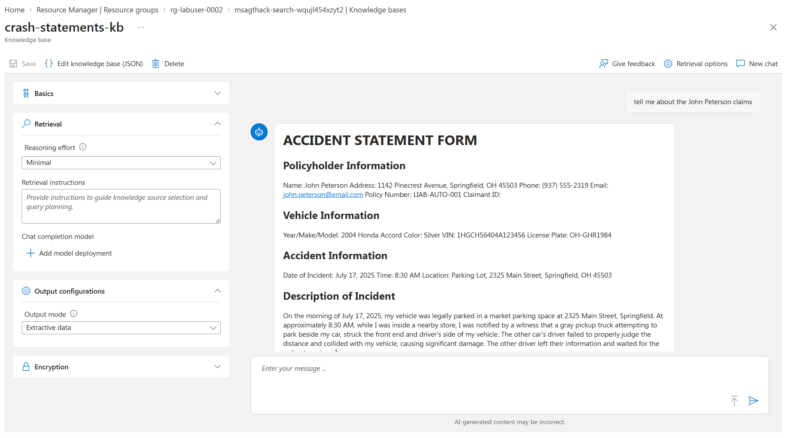
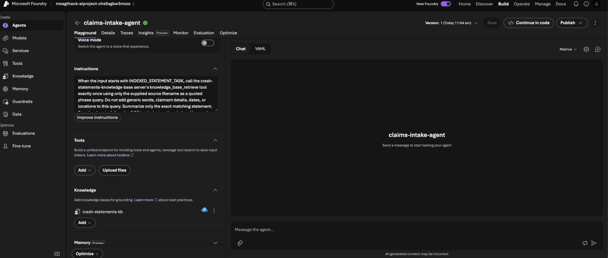
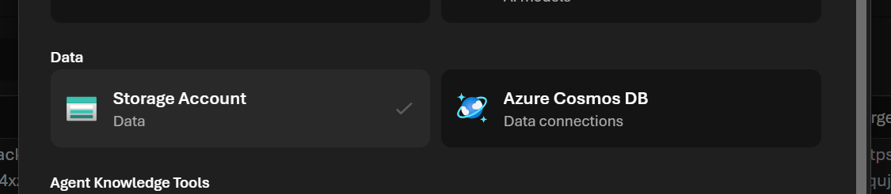

# Challenge 2 - Build the Claims Intake Agent

[Home](../README.md)

**Expected Duration:** 45 minutes

## Overview
In this challenge, you will build the first production-facing agent in the workflow: the Claims Intake Agent.

The Claims Intake Agent must do two things in one flow:

1. Process a claim image using the `mistral-document-ai-2512` deployment.
2. Query the `crash-statements` Azure AI Search index to retrieve related statement evidence.

You will OCR the statement images, create a Foundry IQ knowledge base to explore retrieval in the portal, and create the agent using the Microsoft Foundry SDK. In the supplied implementation, the agent calls the `crash-statements-kb` knowledge base through its MCP endpoint, so its retrieval uses Foundry IQ's managed retrieval over the `crash-statements` index. At the end of this challenge, you will have a single JSON intake artifact that combines OCR output and retrieved crash statement context.

### Foundry IQ: From search indexes to knowledge bases

Enterprise RAG solutions have traditionally been built on Azure AI Search, where developers were responsible for managing search indexes, document ingestion pipelines, chunking strategies, vector embeddings, indexers, and retrieval logic. While this approach provides maximum flexibility, it also introduces operational complexity and requires significant effort to scale across multiple data sources and AI applications.

Foundry IQ builds on the proven retrieval capabilities of Azure AI Search, introducing a higher-level abstraction through **Knowledge Bases**. Rather than connecting agents directly to individual search indexes, developers can aggregate multiple knowledge sources—including SharePoint, Azure Blob Storage, OneLake, web content, and other enterprise systems—into a single reusable knowledge base. Foundry IQ automatically handles indexing, synchronization, retrieval planning, source selection, grounding, and security enforcement, enabling teams to focus on delivering business value instead of managing retrieval infrastructure.

In essence, Azure AI Search remains the underlying retrieval engine, while Foundry IQ provides the context engineering layer that transforms enterprise knowledge into AI-ready context for agents and applications. This evolution significantly reduces the complexity of building grounded AI solutions while enabling knowledge to be reused consistently across multiple agents and use cases.

## Prerequisites

- Complete [Challenge 1](challenge-01.md).
- Confirm that the MicroHack platform or your event coach supplied the Azure
  resources and the values required by `.env.example`.
- Ensure your crash statements are indexed in Foundry IQ (for example, through your Azure AI Search index used by Foundry).
- Have your Github Codespaces up and running.

## Tasks

### Task 1: Populate the crash statements search index

The Claims Intake Agent retrieves through the `crash-statements-kb` knowledge base, which queries an index named `crash-statements`. The Task 1 script creates this index if it does not already exist, then loads it with crash statement content. You only need to run the script before running the agent.

#### The index schema

The `crash-statements` index is created with this schema:

```json
{
  "name": "crash-statements",
  "fields": [
    { "name": "id", "type": "Edm.String", "key": true, "filterable": true },
    { "name": "content", "type": "Edm.String", "searchable": true },
    { "name": "source_file", "type": "Edm.String", "filterable": true },
    { "name": "claimant_name", "type": "Edm.String", "searchable": true, "filterable": true },
    { "name": "policy_number", "type": "Edm.String", "filterable": true }
  ]
}
```

**How to check the schema:** the index is created when you run the upload script in the next section, so check it after that run.

1. In the [Azure portal](https://portal.azure.com), open your Azure AI Search service.
2. Under **Search management**, select **Indexes**, then open `crash-statements`.
3. Compare the fields with the list above. Confirm that `id` is the key, and that `content` and `claimant_name` are searchable.

Task 2 adds retrievable fields and a semantic configuration to this index. The fields you see after that step can differ from this list, and that difference is expected.

#### Upload crash statement documents

Every claim's statement images under `data/claims/` need to be OCR'd and uploaded as documents so the index contains evidence for all five crashes, not just one. Run [`docs/index_crash_statements.py`](../docs/index_crash_statements.py) to do this for the whole folder in one pass:

```bash
cd docs
python index_crash_statements.py
```

The script walks every `data/claims/crash{1-5}/raw/statements/*.jpeg` file, runs Mistral Document AI OCR on each one, and uploads the result to the `crash-statements` index using the same `@search.action` upload shape shown below (one document per statement image, keyed by file name, for example `crash1_front`, `crash1_back`, `crash2_front`, and so on):

```json
{
  "value": [
    {
      "@search.action": "mergeOrUpload",
      "id": "crash1_front",
      "content": "Claimant: John Peterson. Policy: C1A8-AU1D-001. Claim date: July 17, 2025. Vehicle: 2004 Honda Accord, VIN 1HGCM56404A123456, plate OH-GHR1984. Incident: On the morning of July 17, 2025, my vehicle was legally parked in a market parking space at 2325 Rain Street, Springfield...",
      "source_file": "crash1_front.jpeg",
      "claimant_name": "John Peterson",
      "policy_number": "C1A8-AU1D-001"
    }
  ]
}
```
You should get the answer of `Done. Indexed 10 statement documents`.

??? tip "💡 Why did I run this step?"

    **Why OCR first.** The statements are scanned images. Search and the agent can only match text, so
    Mistral Document AI turns each image into text before anything is indexed.

    **Why one document per statement, keyed by file name.** Each statement becomes a searchable document
    with its claimant, policy, and source file. The source file name lets the agent cite where a fact came from.

    **Why `mergeOrUpload`.** Running the script again updates the existing documents instead of creating
    duplicates, so the step is safe to repeat.

    **Why all five crashes.** The agent in Task 5 must find evidence for any claim, not only the first one.

    **What to take away.** Retrieval is only as good as the indexed text. If an answer in later steps looks
    wrong, check the index content before you change the agent.

### Task 2: Understand Foundry IQ knowledge bases, then create one

A raw Azure AI Search index is just a searchable document store. Querying it well — writing filters, choosing a query type, ranking results — is work your application (or the agent) has to do itself every time. Foundry IQ takes a different approach: it puts a managed retrieval layer on top of one or more indexes, so the agent can ask a question in natural language and let Azure AI Search plan and execute the query for it. That managed layer is built from two objects:

- **Knowledge source** — a reusable reference to a data source. In this challenge its kind is `searchIndex`, meaning it wraps the `crash-statements` index you just populated: which fields are searchable, which are returned in results, and which semantic configuration to rank with. A knowledge source doesn't hold data itself; it just describes how to read from something that does.
- **Knowledge base** — the managed retrieval object you can explore in the Azure AI Search portal. It references one or more knowledge sources and exposes a retrieval endpoint, including MCP. This challenge creates the knowledge base, which the supplied agent also calls through its MCP endpoint.

In short, the portal exercise follows **index → knowledge source → knowledge base → portal retrieval**. The supplied agent follows **index → knowledge source → knowledge base → MCP tool → agent**. The knowledge base does not replace the index; the supplied code attaches the `crash-statements-kb` knowledge base to the agent through its MCP connection.

### Create the knowledge source and knowledge base

Run [`docs/create_knowledge_base.py`](../docs/create_knowledge_base.py):

```bash
cd docs
python create_knowledge_base.py
```

This script does three things against the `crash-statements` index:

1. **Makes fields retrievable and adds a semantic configuration.** The index created in Task 1 only marks `id` as retrievable — a knowledge source needs every field it returns (`content`, `source_file`, `claimant_name`, `policy_number`) to be retrievable, and agentic retrieval requires a semantic configuration to rank results. Both attributes can be changed on an existing index without rebuilding it.
2. **Creates a `SearchIndexKnowledgeSource`** named `crash-statements-ks` that wraps the index, using the new semantic configuration and the fields listed above.
3. **Creates a `KnowledgeBase`** named `crash-statements-kb` that references that knowledge source, and prints its MCP endpoint:

   ```text
   https://<your-search-service>.search.windows.net/knowledgebases/crash-statements-kb/mcp?api-version=2026-08-01-preview
   ```

   The helper uses `FOUNDRY_IQ_MCP_API_VERSION` when set; otherwise it uses
   `2026-08-01-preview` for this lab's Search service. The Foundry project's
   `crash-statements-kb` RemoteTool connection must use the **same** MCP URL;
   changing `.env` alone does not update the connection.

### Verify the knowledge base retrieves crash statements

1. Sign in to the [Azure portal](https://portal.azure.com) using the account and
  tenant provided for the lab.
2. In the portal search bar, search for **Azure AI Search**, and then open the
  search service created for your lab. You can identify the correct service by
  matching its name to the host in `FOUNDRY_IQ_SEARCH_ENDPOINT` in your `.env` file (for example, `https://<search-service>.search.windows.net`).
3. In the search service menu, expand **Agentic retrieval**, and then select
  **Knowledge bases**. This area is the Azure AI Search surface that supports
  Foundry IQ knowledge bases.
4. Confirm that `crash-statements-kb` appears in the list, and then select it to
  open its chat playground.
5. Check that the knowledge base references the `crash-statements-ks` knowledge
  source. If the knowledge source is missing, return to **Agentic retrieval** >
  **Knowledge sources** and confirm that `crash-statements-ks` exists and wraps
  the `crash-statements` index.
6. On this new pane:

   1. Select a **Reasoning Effort** option under **Retrieval**.
   2. Select an **Output Mode** option under **Output Configurations**.
   3. In the knowledge base chat box, enter a question that should match one of
      the indexed statements. For example:

      ```text
      Find the crash statement for policy COMM-AUTO-001. Summarize the claimant,  vehicle, incident location, and whether the retrieved evidence is consistent.
      ```

7. Submit the question and verify that the response cites content from
  `crash-statements-ks`, including John Peterson and policy
  `C1A8-AU1D-001`. Selecting Minimal as Reasoning Effort and Extractive data as Output Mode, you will find an answer such as the following:



Before continuing, experiment with these two settings:

**Reasoning Effort** controls how much LLM processing Azure AI Search uses to
plan retrieval. **Minimal** sends the query directly to the knowledge source
for the lowest latency and cost. **Low** performs one LLM-planned retrieval
pass. **Medium** can perform a deeper follow-up search when the first results
are insufficient, which can improve completeness but increase latency and
cost. **Auto**, when available, selects the depth for each request.

**Extractive data** returns the most relevant passages from the source
documents instead of generating a synthesized natural-language answer. This
mode helps you inspect the retrieved evidence directly and is required when
**Minimal** reasoning effort is selected.

Run the same question with **Minimal** and **Low** reasoning effort. Where
available, also try **Medium** or **Auto**. Compare the returned passages,
citations, response time, and activity log. Then switch between **Extractive
data** and **Answer synthesis** to observe the difference between raw grounding
evidence and a generated, citation-backed answer.

8. Select the debug or activity icon underneath the response. Confirm that the
  activity log shows a retrieval operation against `crash-statements-ks` and a
  nonzero result count. The log also shows the generated search query, elapsed
  time, and answer-synthesis activity.

If `crash-statements-kb` doesn't appear, refresh the page and verify that you
opened the search service whose endpoint was used when you ran
[`docs/create_knowledge_base.py`](../docs/create_knowledge_base.py). Also confirm
that the script completed without an error and printed the MCP endpoint for
`crash-statements-kb`.

For more information about this portal experience, see the
[Azure AI Search agentic retrieval quickstart](https://learn.microsoft.com/azure/search/get-started-portal-agentic-retrieval).


### Task 3: Understand how the agent is created with the Foundry SDK (no action required)

Before giving the agent any enterprise data, look at how it is created. `docs/claims-intake-agent.py` uses the `azure-ai-projects` SDK to register the agent as a first-class Foundry resource, instead of calling a chat completion API directly:

```python
client = AIProjectClient(endpoint=project_endpoint, credential=DefaultAzureCredential(), allow_preview=True)

definition = PromptAgentDefinition(
    model=model_deployment,
    instructions=FOUNDRY_AGENT_INSTRUCTIONS,
)
client.agents.create_version(agent_name=FOUNDRY_AGENT_NAME, definition=definition)
```

Key points:

- `PromptAgentDefinition` describes the agent's model, instructions, and, in Task 4, the tools it uses for grounding.
- `client.agents.create_version(...)` registers the agent in your Foundry project so it can be reused across runs, versioned, and inspected in the Foundry portal.
- `_ensure_foundry_agent()` in the script checks `client.agents.get(FOUNDRY_AGENT_NAME)` first. It creates a new version only when the model, instructions, or MCP tool differ from the latest version, so re-running the script won't create duplicate agents.
- The agent is invoked through `client.get_openai_client(agent_name=...)`, which returns an OpenAI-compatible client whose `responses.create(...)` call runs the named agent.

At this point the agent can already summarize OCR text using the model alone — it has no grounding in your crash statement evidence yet. That's the enterprise need you'll add next.

### Task 4: Understand how the supplied agent calls the Foundry IQ knowledge base (no action required)

Foundry IQ grounds the supplied agent in the crash statements. Task 1 indexes the statements in the `crash-statements` Azure AI Search index. The `crash-statements-kb` knowledge base you created in Task 2 is Foundry IQ's managed retrieval layer over that index. The supplied agent calls this knowledge base through its MCP endpoint, so every retrieval uses Foundry IQ's managed retrieval, and the agent's answers are grounded in the same statements.

```python
def _get_knowledge_connection_id(
    client: AIProjectClient, knowledge_base_name: str, expected_url: str
) -> str:
    """Find the RemoteTool connection that targets the Foundry IQ knowledge base."""
    expected_name = os.environ.get("FOUNDRY_IQ_CRASH_STATEMENTS_CONNECTION_NAME", "")
    connections = [
        connection
        for connection in client.connections.list()
        if getattr(connection.type, "value", connection.type) in {"RemoteTool", "RemoteTool_Preview"}
    ]
    if expected_name:
        connection = next(
            (item for item in connections if item.name == expected_name or item.id == expected_name),
            None,
        )
    else:
        connection = next(
            (item for item in connections if knowledge_base_name in (getattr(item, "target", "") or "")),
            None,
        )

    if connection is None:
        raise RuntimeError(
            f"No Foundry RemoteTool connection targets '{knowledge_base_name}'. "
            "Redeploy labautomation/azuredeploy.json, then rerun the intake agent."
        )
    if connection.target != expected_url:
        raise RuntimeError(
            f"Foundry RemoteTool connection '{connection.name}' targets {connection.target}, "
            f"but the agent expects {expected_url}. Update the Foundry project's RemoteTool "
            "connection target (see Challenge 2 troubleshooting)."
        )
    return connection.id


def _build_crash_statements_knowledge_tool(client: AIProjectClient) -> MCPTool:
    """Build the MCP tool that retrieves indexed crash statements through Foundry IQ."""
    search_endpoint = (
        os.environ.get("FOUNDRY_IQ_SEARCH_ENDPOINT")
        or os.environ.get("SEARCH_SERVICE_ENDPOINT", "")
    ).rstrip("/")
    if not search_endpoint:
        raise RuntimeError("FOUNDRY_IQ_SEARCH_ENDPOINT is not set. Complete Task 1 first.")

    server_url = (
        f"{search_endpoint}/knowledgebases/{CRASH_STATEMENTS_KNOWLEDGE_BASE_NAME}"
        f"/mcp?api-version={MCP_API_VERSION}"
    )
    return MCPTool(
        server_label=CRASH_STATEMENTS_SERVER_LABEL,
        server_url=server_url,
        require_approval="never",
        allowed_tools=["knowledge_base_retrieve"],
        project_connection_id=_get_knowledge_connection_id(
            client, CRASH_STATEMENTS_KNOWLEDGE_BASE_NAME, server_url
        ),
    )
```

Key points:

- `_get_knowledge_connection_id` finds the `RemoteTool` connection that targets `crash-statements-kb` and checks that its URL matches the agent's tool URL. The lab deployment provisions that connection.
- `MCPTool` points at the knowledge base's MCP endpoint, using `FOUNDRY_IQ_SEARCH_ENDPOINT` and `FOUNDRY_IQ_MCP_API_VERSION`.
- **Why both `server_url` and `project_connection_id`?** `server_url` tells the agent which MCP server and tools to use. `project_connection_id` refers to the Foundry project connection that supplies the project's managed identity and its access to Azure AI Search, without putting a Search key in the agent. The connection also stores a target URL; Foundry uses **the connection's target** if it differs from `server_url`. That is why the script checks that both URLs match before running the agent. Changing `.env` only changes `server_url`, not the stored connection.
- `allowed_tools=["knowledge_base_retrieve"]` and `require_approval="never"` limit the agent to the one retrieval call the instructions ask for.
- The agent's instructions ask it to call the `knowledge_base_retrieve` tool to ground its statement summary. Model tool selection remains part of the agent interaction.
- When the agent's model, instructions, or MCP tool differ from the latest version, `_ensure_foundry_agent()` creates a new version. Re-running the script with unchanged settings does not create one.

The same knowledge base from Task 2 is what the agent calls, so a matching statement in the portal retrieval confirms that the knowledge base is working.

### Task 5: Run the Claims Intake Agent

Use an accident statement form image under `data/claims/{claim-id}/raw/statements/`, not the reference photos in `data/claims/{claim-id}/raw/vehicle-damage/`. The `raw/vehicle-damage/*.jpg` files are generic damage photos with no text, so OCR on them produces no usable content and the search tool returns zero matches. The `raw/statements/*_front.jpeg` and `*_back.jpeg` files contain the actual handwritten claim forms that match the indexed crash statement content.

```bash
cd docs
python claims-intake-agent.py ../data/claims/crash1/raw/statements/crash1_front.jpeg
```

Optional output path:

```bash
python claims-intake-agent.py ../data/claims/crash1/raw/statements/crash1_front.jpeg --output ../challenges/intake_result_crash1.json
```
??? tip "💡 Why did I run this step?"

    **Why a statement and not a damage photo.** Damage photos contain no text. OCR returns nothing, so the
    search has nothing to match. Choosing the right input is the first thing to check when a result is empty.

    **Why the agent retrieves instead of Python searching.** The agent decides what to ask the knowledge base,
    then combines the retrieved statement text with the OCR result in one structured output.

    **Why the JSON file matters.** The intake JSON is the handoff between this challenge and Challenges 3 and 4.
    The intelligence agent reads it, so its fields must be complete and correct.

    **What to take away.** When a result looks wrong, check the input first, then the retrieval, then the reasoning.

??? question "🛠️ If the agent reports 'api-version ... does not exist'"

    The knowledge base MCP endpoint is versioned. Foundry uses **both** the agent's MCP tool URL and the
    project's `crash-statements-kb` RemoteTool connection. The intake agent can refresh its tool URL when you rerun
    it, but it cannot update the project connection. A stale connection URL can therefore cause this
    error even when your `.env` and the agent both use `2026-08-01-preview`.

    1. Check `FOUNDRY_IQ_MCP_API_VERSION` in your `.env` (or your shell). For this lab, use
       `2026-08-01-preview`; remove an older override.
    2. In the Foundry portal, open **Manage** > **Project details** > **Connected resources**. Find the
       `crash-statements-kb` RemoteTool connection and check its target URL. It must end with
       `/knowledgebases/crash-statements-kb/mcp?api-version=2026-08-01-preview`. A stale target such as
       `api-version=2026-04-01` will be rejected by Search.
    3. If the connection has a stale target, sign in to Azure with `az login` if needed. From the
       `docs` folder used in the steps above, run this command in either Bash/zsh or PowerShell:

       ```text
       python fix_crash_statements_connection.py
       ```

       The helper reads `.env` from the repository root and finds the existing RemoteTool connection in your Foundry project.
       It checks that the Search service, connection type, and project managed identity match before
       updating **only** the stale target URL. It uses your Azure sign-in, not the Search API key.
       If the connection is missing or you lack permission to update it (Foundry Project Manager on the
       parent Foundry resource), it stops with an error rather than creating a new connection.
       Confirm it reports `api-version=2026-08-01-preview`, refresh **Connected resources**, and rerun
       the intake agent. This does not redeploy the lab.
    4. If the versions match and the error remains, tell your coach the Search service name and the two
       versions; do not share keys.

### Task 6: Test your Agent in the Portal

1. In the [Microsoft Foundry portal](https://ai.azure.com), select **Build** > **Agents**, then open `claims-intake-agent`.
2. On the **Playground** tab, review the agent's **Instructions** and confirm `crash-statements-kb` appears under **Knowledge**. The version selector at the top shows which agent version you are testing. This knowledge-base connection lets the agent call Foundry IQ to retrieve evidence from the `crash-statements` index.



3. In the chat pane, enter this prompt and select **Send**:

  ```text
  Find the crash statement for policy COMM-AUTO-001. Summarize the claimant,
  vehicle, incident location, and whether the retrieved evidence is consistent.
  ```

   Confirm that the response identifies John Peterson and is grounded in the indexed
   statement evidence. This portal playground test does not change the MCP knowledge-base
   tool described in Task 4.

??? tip "💡 Why did I run this step?"

    The playground is a quick check of the **agent and its knowledge-base connection**: can the
    selected agent version call Foundry IQ and ground an answer in indexed crash statements?
    Checking **Knowledge** first confirms the intended source is attached; checking the answer
    helps catch a disconnected tool or missing evidence before moving on. This prompt does **not**
    process an image or test OCR. The earlier `claims-intake-agent.py` run is the end-to-end test
    that combines OCR with retrieval, so both checks tell you where a failure happened.

### Task 7: Optional, connect Foundry to the blob storage account

The lab deployment creates a Storage account with a `claims-data` container that can hold claim images and documents for direct processing from Foundry, instead of relying only on local files. If you want to validate the setup in the Foundry portal, connect this Storage account to your Foundry project so agents and tools in the portal can read from it.

1. Open the [Microsoft Foundry portal](https://ai.azure.com).

2. On the top bar, go to **Manage** > **Project details** > **Connected resources**.


3. Select **Add connection**.
4. Choose **Azure Blob Storage** as the connection type.



5. Select the Storage account supplied with your lab.
6. Set the authentication method to **API key**, then confirm the connection name (for example, `claims-data-storage`).
7. Select **Add connection** to finish.
8. Verify the connection appears under **Connected resources** with a status of **Connected**.

With this connection in place, Foundry can list and read blobs from the `claims-data` container directly, so you can point future tasks and agents at blob paths instead of copying files locally first. [Challenge 3](./challenge-03.md) builds on this same pattern — creating an agent with the SDK, then giving it an enterprise need — using your Storage account's `policies` container instead of Foundry IQ.


## Validation checklist

- [ ] The `crash-statements` index contains statement documents for all five crashes (the indexing script reports the count).
- [ ] The `crash-statements-kb` knowledge base appears under **Agentic retrieval** in the Azure AI Search portal, and a portal retrieval returns a statement.
- [ ] OCR call succeeds with `status: success`.
- [ ] The `claims-intake-agent` agent appears under your Foundry project's agents (visible via the SDK or the Foundry portal).
- [ ] At least one crash statement match is returned from the `crash-statements-kb` knowledge base.
- [ ] Output JSON is created and contains `ocr`, `foundry_iq`, and `agent_summary` sections.
- [ ] (Optional) The Storage account connection appears under **Connected resources** in the Foundry portal with a status of **Connected**.

## Next step

Continue with [Challenge 3](./challenge-03.md) to ground coverage decisions in
enterprise policy documents.
