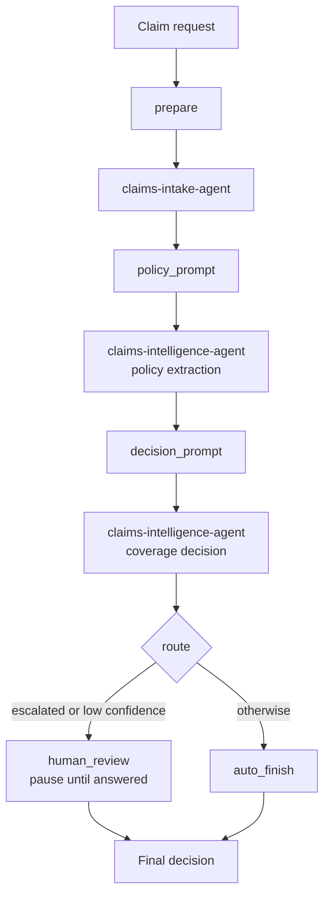

# Challenge 4 - Build the Claims Workflow with Agent Framework and Deploy It as a Hosted Agent

[Home](../README.md) | [Challenge 3](./challenge-03.md) | [Challenge 5](./challenge-05.md) | [Challenge 6](./challenge-06.md)

**Expected Duration:** 45 minutes (+ 20 minutes for the optional deployment)

## Overview

Challenges 2 and 3 created the intake and intelligence agents. This challenge connects
them with Microsoft Agent Framework's **workflow** support. The
workflow is a graph: each **node** does one job and each **edge** says where the result
goes next.

The intake agent retrieves the indexed accident statement. The intelligence agent
retrieves the policy, then evaluates coverage using that policy and the claim details.
The graph routes an escalated or low-confidence decision to a human reviewer before
returning the final result.

You will:

1. Inspect the graph and its routing logic.
2. Run claims locally and inspect the coverage decision.
3. Respond to a human-review request when the workflow pauses.
4. Optionally inspect the local server with the Foundry Toolkit and deploy it as a hosted agent.

The workflow reuses `claims-intake-agent` and `claims-intelligence-agent`; it does not
create replacement agents or copy their stored instructions. After this challenge,
continue to [Challenge 5](./challenge-05.md) to observe and evaluate the agent calls.



The two Foundry agents are nodes of the graph. The small nodes between them only build the
next prompt from the previous answer. The `route` node decides which branch runs.

> [!NOTE]
> The workflow reads the accident statement from the index populated in Challenge 2.
> If you pass an image path, only its file name is used to find the indexed statement,
> so the image must already be indexed. This command does not upload the image or run OCR.

## Prerequisites

In this page, **workshop root** means the root of your cloned repository, containing
`azure.yaml`, `pyproject.toml`, `docs/`, and `agent-framework/`.

- Complete [Challenge 2](./challenge-02.md) and [Challenge 3](./challenge-03.md). Both agents
  must exist, and the crash statements must be indexed.
- Use the standard Python environment (`uv sync`) from the earlier challenges for
  Tasks 1-3. The optional local hosting server in Task 4 needs a separate Python 3.11
  environment because its hosting adapter uses a newer Agent Framework.

<a id="starting-directly-at-challenge-4"></a>

<details markdown="1">
<summary><strong>Starting directly at Challenge 4 (optional setup)</strong></summary>

Use this section if you are joining here, using a fresh checkout, or have deleted your
local environments. These are the prerequisites that would already be in place if you
had followed Challenges 1-3. **A fresh local setup does not recreate the Azure agents or
their indexed data.**

<details markdown="1">
<summary>Azure prerequisites from Challenges 1-3 (expand to check before starting)</summary>

| Earlier challenge | What must already exist | How to check |
|---|---|---|
| [Challenge 1](./challenge-01.md) | Access to the correct subscription, resource group, and Foundry project, with its model deployment (the lab uses `gpt-5.4`), Azure AI Search service, and Storage policy documents | Open the assigned project in the Foundry portal; obtain its **project endpoint**, tenant ID, and subscription ID from your coach or existing deployment |
| [Challenge 2](./challenge-02.md) | `claims-intake-agent`, a populated `crash-statements` search index, and its configured retrieval tool/connection | Check **Agents** in Foundry and the Search index; `crash1_front.jpeg` and `crash3_front.jpeg` must be indexed for the examples below |
| [Challenge 3](./challenge-03.md) | `claims-intelligence-agent`, the `policies-kb` knowledge base, and working policy retrieval connections | Check **Agents** and its tools; verify that `COMP-AUTO-001` can be retrieved from the policy knowledge base |
| Access | Your signed-in user can invoke both agents, and their configured connections can access the data | Have **Foundry User** on the project (or equivalent permissions); being able to see a resource group alone does not grant agent access |

The workflow **reuses** these two agents; it does not create them, index documents, or
repair retrieval connections. If any item is missing, complete the linked challenge
or ask your coach for a prepared project before proceeding. The local workflow reads
indexed statements, so it does not need to run Mistral OCR again.

</details>

#### 1. Open the correct folder and install local tools

Open the cloned repository root, not just `agent-framework/` or `docs/`. It contains
`pyproject.toml`, `uv.lock`, `.env.example`, `azure.yaml`,
`docs/`, and `agent-framework/`.

You need **Python 3.11**, [uv](https://docs.astral.sh/uv/getting-started/installation/),
and [Azure CLI](https://learn.microsoft.com/cli/azure/install-azure-cli).
The Claims Hack Codespace supplies these tools. For a local workstation, install them
first. VS Code with the Foundry Toolkit is only required for the optional Inspector
and Toolkit deployment steps; `azd` is only needed if you choose the azd deployment route.
Neither Docker nor a hosted-agent deployment is required to run the local CLI.

#### 2. Create and activate the participant environment

Run from the workshop root:

=== "Bash/zsh"

    ```bash
    uv sync --refresh --python 3.11 --default-index https://pypi.org/simple
    source .venv/bin/activate
    python --version
    ```

=== "PowerShell"

    ```powershell
    uv sync --refresh --python 3.11 --default-index https://pypi.org/simple
    .\.venv\Scripts\Activate.ps1
    python --version
    ```

The Python version must be `3.11.x`. This installs the pinned root dependencies for
Tasks 1-3 and Challenges 5-6. Do **not** install `agent-framework/requirements.txt`
into this environment: Task 4 creates a separate hosting environment with different
package versions.

In a new terminal, return to this folder and activate `.venv` again. Avoid bare
`uv run` while the hosting environment is active: it may select the root project
environment instead of the hosting environment.

#### 3. Sign in to the existing Azure environment

Replace the placeholders with the tenant and subscription that own your lab:

```console
az login --use-device-code --tenant "<tenant-id>"
az account set --subscription "<subscription-id>"
```

The CLI uses `DefaultAzureCredential`, which can use your Azure CLI login.
Use the same lab identity that has access to the two prompt agents. See
[Azure Identity authentication](https://learn.microsoft.com/python/api/overview/azure/identity-readme)
for credential-chain behavior.

#### 4. Restore the workshop-root environment file

If you still have a valid `.env`, keep it. If it was deleted, choose **one** method:

**Existing Claims MicroHack deployment:** from the workshop root, regenerate the
configuration as in Challenge 1. In Bash/zsh:

```bash
bash labautomation/get-keys.sh --resource-group "<your-resource-group-name>"
```

In PowerShell:

```powershell
.\labautomation\get-keys.ps1 -ResourceGroup "<your-resource-group-name>"
```

This replaces the root `.env`. It requires permission to read deployment outputs and
list resource keys, even though the workflow itself only needs agent invocation
permissions. Both scripts write the same file. It does not redeploy Azure resources or
recreate the two agents.
Alternatively, use the manual method below.

**Existing prepared Foundry project / no key-list permissions:** copy the template
only if `.env` does not exist:

=== "Bash/zsh"

    ```bash
    cp -n .env.example .env
    ```

=== "PowerShell"

    ```powershell
    if (-not (Test-Path .env)) { Copy-Item .env.example .env }
    ```

Edit the **workshop-root** `.env` in VS Code. For the local workflow, set both
endpoint entries to the same existing **project endpoint**, not the resource endpoint:

```dotenv
FOUNDRY_PROJECT_ENDPOINT=https://<foundry-resource>.services.ai.azure.com/api/projects/<project-name>
AI_FOUNDRY_PROJECT_ENDPOINT=https://<foundry-resource>.services.ai.azure.com/api/projects/<project-name>
HUMAN_REVIEW_CONFIDENCE_THRESHOLD=0.9
```

The workflow uses the existing agents' deployed models and retrieval connections.
The local CLI does not need Search keys, a Storage connection string, or a Mistral key.
Those other template values are needed only if you rerun earlier setup scripts.
If your prepared agents use different names, also set `CLAIMS_INTAKE_AGENT_NAME` and
`CLAIMS_INTELLIGENCE_AGENT_NAME` in `.env`.
Keep this file local; do not commit credentials.

#### 5. Check imports, then run an indexed claim

From the workshop root, with `.venv` active:

```bash
python -c "from agent_framework import WorkflowBuilder; from agent_framework.foundry import FoundryAgent; from azure.identity.aio import DefaultAzureCredential; from dotenv import load_dotenv; print('Local imports OK')"
python docs/claims-framework-workflow.py --help
cd docs
python claims-framework-workflow.py --indexed-claim crash1 --policy COMP-AUTO-001
```

Imports and `--help` are offline checks; they do not prove Azure access or retrieval
works. The final command calls the existing agents, consumes model tokens, and may
pause for human review. Answer `approve`, `escalate`, or `deny` if requested.
If it fails with `401`/`403`, check the signed-in tenant and project permissions.
If it cannot find a statement or policy, revisit the Challenge 2/3 prerequisites.

After this check, return to the workshop root with `cd ..` and continue with Task 1.
Task 2 starts with `cd docs`; do not run that command a second time while already in
`docs`.

</details>

## Tasks

### Task 1: Look at the workflow (no action needed)

Open `agent-framework/workflow.py`. It has three kinds of building blocks:

| Part | What it is |
|---|---|
| `FoundryAgent(...)` | Connects to an existing Foundry agent by name. The workflow uses the agents from Challenges 2 and 3. |
| `Executor` classes (`Prepare`, `PolicyPrompt`, ...) | Small nodes. Each receives the previous result, does one step, and sends a message on. |
| `WorkflowBuilder(...).add_edge(a, b)` | The edges. A `condition=` on an edge picks the branch, as `route` does for human review. |

> [!IMPORTANT]
> Do not modify the workflow code. It uses the policy and decision instructions that are
> already stored in `claims-intelligence-agent`.

### Task 2: Run the workflow locally

From the workshop root, enter `docs` and run the comprehensive-policy example.
The file name identifies the indexed accident statement, and `--policy COMP-AUTO-001`
selects the comprehensive policy for coverage evaluation:

```bash
cd docs
python claims-framework-workflow.py ../data/claims/crash1/raw/statements/crash1_front.jpeg --policy COMP-AUTO-001
```

The runner accepts these inputs:

| Argument | What it controls |
|---|---|
| Image path | Identifies an already-indexed statement by file name; does not upload or OCR the image |
| `--indexed-claim` | Identifies an indexed statement directly, for example `crash1`; use this instead of an image path |
| `--policy` | Overrides the policy number retrieved from the statement; omit it to use the statement's policy |
| `--claim-id` | Sets the claim identifier in the result (default: `CLM-2026-001`) |
| `--amount` | Sets the amount to evaluate against coverage limits and deductibles (default: `15000` USD) |

Run these examples from `docs` to exercise different inputs:

```bash
# default liability-only denial path
python claims-framework-workflow.py ../data/claims/crash1/raw/statements/crash1_front.jpeg

# override claim id and amount
python claims-framework-workflow.py ../data/claims/crash1/raw/statements/crash1_front.jpeg --policy COMM-AUTO-001 --claim-id CLM-2026-007 --amount 28000

# an indexed claim by reference
python claims-framework-workflow.py --indexed-claim crash1 --policy COMP-AUTO-001
```

The first example without `--policy` uses the statement's liability-only policy and
should deny own-vehicle collision damage. The commercial-policy example tests a different
policy and claimed amount. The indexed-reference example retrieves the statement without
requiring a local image path.

The console reports intake as Step 1 and intelligence processing as Step 2, then prints
the result JSON. Check `status`, the retrieved `policy_info`, and `coverage_decision`,
including its reasoning, deductible, and approved amount. If review is required,
Step 3 waits for your response before printing the final decision.

### Task 3: Complete human-in-the-loop review when requested

If the intelligence agent escalates, or its confidence is below the threshold (`0.90`, or
`HUMAN_REVIEW_CONFIDENCE_THRESHOLD` in the workshop-root `.env`), the workflow pauses at the
`human_review` node:

```text
[Step 3] Human review requested...
    Decision status: APPROVED | confidence: 0.74 | threshold: 0.90
    Workflow paused. Waiting for human-in-the-loop input.
    Type 'approve' to accept, 'escalate' for manual review, or 'deny' to override.
```

Enter one of these reviewer actions:

* `approve` accepts the agent's original status
* `escalate` sets the final status to `ESCALATED`
* `deny` overrides the final status to `DENIED`

An answer can be followed by a comment (`deny missing police report`), which is stored in
`human_review.comment`. Any other answer asks again.

The workflow keeps the review request as data instead of blocking on the keyboard. That is
what lets the same workflow wait for a reviewer when it runs as a hosted agent in Task 5.

> [!IMPORTANT]
> Run the command in an interactive terminal so you can answer a review request.
> A non-interactive run fails explicitly if review is required.

<a id="task-4-test-and-debug-with-the-foundry-toolkit-agent-inspector-optional"></a>

### Task 4: Test the local workflow server (optional)

Use either **VS Code with Agent Inspector** or the **terminal client script** below.
Both send requests to the same local Responses API server. VS Code is not required
for the script path. Unlike Tasks 2-3, which call the graph directly, this task tests
the HTTP hosting layer used by the deployed container.

#### Start the server (both paths)

1. Keep the workshop-root `.env` and Azure CLI login from the earlier tasks.
2. In a new terminal at the workshop root, create a separate environment for hosting (it needs a newer Agent Framework than the
   other challenges):

    === "Bash/zsh"

        ```bash
        cd agent-framework
        python3.11 -m venv .venv
        source .venv/bin/activate
        pip install -r requirements-dev.txt
        ```

    === "PowerShell"

        ```powershell
        Set-Location agent-framework
        py -3.11 -m venv .venv
        .\.venv\Scripts\Activate.ps1
        pip install -r requirements-dev.txt
        ```

3. From `agent-framework`, with its `.venv` active, start the server:

    ```bash
    python main.py
    ```

    Leave this terminal running. The server must be listening on port `8088` before
    you use either client below. Do not start a second server on the same port.

    **Why `ResponsesHostServer` matters**

    [`main.py`](../agent-framework/main.py) loads the workshop-root `.env`, then starts
    the workflow through `ResponsesHostServer`, provided by the
    `agent-framework-foundry-hosting` package. The key expression is:

    ```python
    ResponsesHostServer(
        build_workflow().as_agent(name="claims-workflow")
    ).run(port=int(os.getenv("PORT", "8088")))
    ```

    | Part | What it does |
    |---|---|
    | `build_workflow()` | Builds the graph of executors, agent calls, and conditional human-review edges defined in `workflow.py` |
    | `.as_agent(name="claims-workflow")` | Adapts that graph to the Agent Framework agent interface so the hosting server can invoke it; this does not register a new agent in Foundry |
    | `ResponsesHostServer(...)` | Supplies the HTTP/protocol layer: accepts Responses API requests, invokes the adapted workflow, and exposes its outputs through the Responses API rather than requiring you to write HTTP handlers |
    | `.run(...)` | Starts the server on `PORT`, defaulting to `8088`; the local Responses endpoint is `http://localhost:8088/responses` |

    In Tasks 2-3, the CLI calls the workflow directly in the Python process.
    `ResponsesHostServer` makes the **same graph callable over HTTP**:

    ```text
    Agent Inspector / Responses API client
        -> ResponsesHostServer
        -> workflow.as_agent()
        -> intake -> policy retrieval -> coverage decision -> optional human review
        -> Responses API result or review request
    ```

    This is the bridge to both **local testing** and **hosted deployment**:

    - **Here:** Agent Inspector or `invoke-hosted-claims-workflow.py --local` sends
      requests to the local server instead of importing the workflow.
    - **Human review:** a paused workflow is exposed as a `request_info` function call.
      The caller returns the reviewer's answer as `function_call_output`, using the
      `call_id` and `previous_response_id`, to continue the run. The caller supplies
      the review UI; the server does not prompt in its terminal.
    - **Task 5:** the Docker container starts the same `main.py`. Foundry routes hosted
      requests to this server using the `responses` protocol declared in `azure.yaml`.
      You do not need a separate workflow or a custom web API for deployment.

    Starting this server does **not** deploy or register an Azure resource. Local runs
    still call the existing Foundry prompt agents and require Azure authentication.
    The adapter also does not by itself guarantee durable recovery after a process restart.
    Keep the process running while testing, then stop it with `Ctrl+C`.

    **How this translates to LangChain/LangGraph**

    The commented example at the end of [`main.py`](../agent-framework/main.py) shows
    the equivalent hosting pattern for an existing compiled LangGraph graph, including
    one created with LangChain's `create_agent`. That framework uses
    `ResponsesHostServer` from `langchain_azure_ai.agents.hosting`, not the
    Agent Framework package, and accepts the graph directly without `.as_agent()`.
    The client still uses `/responses`; you change the framework adapter, not write
    a new HTTP API.

    This is an illustration, not a required lab step or an automatic conversion of
    the claims graph. Use a separate environment with the LangChain hosting dependencies
    if you try it with your own app. Human-review interrupt/resume payloads differ, so
    this lab's review client would need adapting. See the
    [official LangChain/LangGraph hosting guide](https://learn.microsoft.com/azure/foundry/how-to/develop/langchain-hosted-agents)
    for a complete example.

#### Test with VS Code and Agent Inspector

1. Open the workshop root in VS Code and install the Foundry Toolkit extension.
2. With the server running, open the Command Palette and run
   **Foundry Toolkit: Open Agent Inspector**. Select the local server at
   `http://localhost:8088` if prompted.
3. Send this request in the Inspector:

    ```text
    --indexed-claim crash3 --policy COMP-AUTO-001
    ```

4. Inspect the final decision or pending `request_info` function call. Review controls
   depend on your Toolkit version. To test the complete interactive review flow reliably,
   use the terminal script below. It starts its own claim run; it does not attach to or
   resume a run started in Agent Inspector.

**Optional local tracing:** start the Toolkit trace collector, stop the workflow server
with `Ctrl+C`, and restart it with the collector's OTLP endpoint (use the port shown by
your Toolkit):

```bash
OTEL_EXPORTER_OTLP_ENDPOINT=http://localhost:4318 \
OTEL_EXPORTER_OTLP_PROTOCOL=http/protobuf python main.py
```

In PowerShell, set `$env:OTEL_EXPORTER_OTLP_ENDPOINT="http://localhost:4318"` and
`$env:OTEL_EXPORTER_OTLP_PROTOCOL="http/protobuf"`, then run `python main.py`.
Trace and graph views depend on your Toolkit version and instrumentation; opening
Agent Inspector alone does not enable trace export. Local workflow spans and remote
prompt-agent traces can be separate.

#### Test with the terminal client script (no VS Code required)

1. Keep the server running in the first terminal. Open a **second, interactive terminal**
   at the workshop root and activate the hosting environment there too:

    ```bash
    source agent-framework/.venv/bin/activate
    ```

    In PowerShell:

    ```powershell
    .\agent-framework\.venv\Scripts\Activate.ps1
    ```

2. From the workshop root, run:

    ```bash
    python docs/invoke-hosted-claims-workflow.py --local --indexed-claim crash3 --policy COMP-AUTO-001
    ```

    `--local` sends the request to `http://localhost:8088/responses`; it does not call
    a deployed hosted agent. The server still invokes your existing Foundry prompt agents.
3. If review is requested, enter `approve`, `escalate`, or `deny` in the **client**
   terminal. The script returns your answer through the API and prints the final decision.
   The server terminal only shows server activity; it does not ask for reviewer input.

#### Force human review for a local test

To force the review branch for testing, stop the server if it is running, then restart it
from the `agent-framework` directory with the threshold set for that process:

=== "Bash/zsh"

    ```bash
    HUMAN_REVIEW_CONFIDENCE_THRESHOLD=1.01 python main.py
    ```

=== "PowerShell"

    ```powershell
    $env:HUMAN_REVIEW_CONFIDENCE_THRESHOLD = "1.01"
    python main.py
    ```

This threshold forces every valid confidence score below `1.01` into human review.
Run the terminal client command above again and answer the review prompt.
After testing, stop the server. Clear the session override:

```powershell
Remove-Item Env:HUMAN_REVIEW_CONFIDENCE_THRESHOLD
```

Restart with `python main.py` to use the threshold from `.env` (default: `0.90`).

#### Run offline tests

In a terminal with the hosting environment active, run from `agent-framework`:

```bash
pytest
```

These tests use fake agents and need neither Azure access nor a running server.

### Task 5: Deploy the workflow as a hosted agent

A hosted agent runs your code in a managed runtime inside your Foundry project. Choose
**one packaging method** and **one deployment tool**; you do not need to deploy twice.

| Method | What you supply | What builds/runs it | Use it when |
|---|---|---|---|
| Container (current `azure.yaml`) | `agent-framework/Dockerfile` and source | ACR builds the Python 3.11 image; Foundry runs it | You want to keep this lab's runtime or control the image and system dependencies |
| Code ZIP (alternative below) | Source, `requirements.txt`, and `codeConfiguration` | The tool uploads a ZIP; Foundry builds dependencies and runs the selected Python runtime | You want source deployment without managing a Dockerfile or ACR |

Both start [`agent-framework/main.py`](../agent-framework/main.py) and expose the
same Responses API. The claim inputs and human-review client remain unchanged.
See the official [container deployment](https://learn.microsoft.com/azure/foundry/agents/how-to/deploy-hosted-agent)
and [source-code deployment](https://learn.microsoft.com/azure/foundry/agents/how-to/deploy-hosted-agent-code)
guides for availability and service prerequisites.

> [!IMPORTANT]
> Check these before you deploy:
>
> - You need the **Foundry Project Manager** role on the Foundry project to create the agent.
> - Run the deployment commands from the **workshop root**, where `azure.yaml` is.
>   The service's source directory is `agent-framework/`.
> - Code ZIP deployment currently supports Python **3.13 or 3.14**, not this lab's local
>   Python 3.11 environment. Test the hosting dependencies and workflow under Python 3.13
>   before using the ZIP example. Do not package the root environment or its lockfile.
> - Deploying can incur charges. A successful upload does not prove readiness; wait for
>   the agent version to become active and run the test below.

#### Choose the package: container or code ZIP

**Container:** keep [`azure.yaml`](../azure.yaml) unchanged. Its relevant settings are:

```yaml
language: docker
docker:
  path: Dockerfile
  context: .
  remoteBuild: true
```

These settings belong to `services.claims-workflow-hosted`. ACR builds the image remotely,
so you do not need a local Docker daemon. The Dockerfile selects Python 3.11 and installs
`agent-framework/requirements.txt`. Review its package index before a remote build;
the Azure builder must be able to reach that index.

**Code ZIP:** edit only the `claims-workflow-hosted` service in the workshop-root
`azure.yaml`. Replace that service with this block, leaving the top-level `name`,
`requiredVersions`, `services.ai-project`, and `infra` sections in place:

```yaml
  claims-workflow-hosted:
    name: ClaimProcessingWorkflow
    project: agent-framework
    host: azure.ai.agent
    language: python
    kind: hosted
    description: Claims workflow over the existing intake and intelligence prompt agents, with human review.
    codeConfiguration:
      runtime: python_3_13
      entryPoint: main.py
      dependencyResolution: remote_build
    uses:
      - ai-project
    protocols:
      - protocol: responses
        version: 2.0.0
    container:
      resources:
        cpu: '0.5'
        memory: 1.0Gi
    env:
      CLAIMS_INTAKE_AGENT_NAME: claims-intake-agent
      CLAIMS_INTELLIGENCE_AGENT_NAME: claims-intelligence-agent
      HUMAN_REVIEW_CONFIDENCE_THRESHOLD: '0.9'
```

`codeConfiguration` selects ZIP deployment; remove the service's `docker` block and
do not add an `image` setting. `container.resources` still specifies compute resources,
not an image. The tool packages the **contents of `agent-framework/`**, so `main.py`,
`workflow.py`, and `requirements.txt` are at the ZIP root. You do not need to create
the ZIP manually.

The checked-in [`.agentignore`](../agent-framework/.agentignore) excludes local secrets,
environments, caches, and tests. Review these exclusions before packaging. Remote dependency
resolution installs `requirements.txt` in Azure; it does **not** inherit your local
pip configuration or the Dockerfile's package index. If your dependencies require a
private feed, use a supported private-dependency packaging approach rather than including
credentials in the archive. Do not bundle a macOS/Windows or Python 3.11 virtual environment
for a Linux Python 3.13 runtime.

The ZIP example does not change the Python 3.11 environment used by the other challenges.
Keep the container path if you have not verified Python 3.13 compatibility.

Both configurations retain `responses` version `2.0.0` and reference your existing
Foundry project, without deploying replacement prompt agents or models.

#### Deploy with Foundry Toolkit (VS Code)

1. Open the cloned **repository root** in VS Code
   and sign in to Azure from the Foundry Toolkit.
2. Open the Command Palette and run **Foundry Toolkit: Deploy Hosted Agent**.
3. Follow the prompts to select your Foundry project. If asked for a workspace folder,
   choose the repository root containing `azure.yaml`.
   The Toolkit may save your selection in `.foundry/.deployment.json`. That file is
   participant-specific and ignored by Git. The checked-in
   [placeholder example](../.foundry/.deployment.example.json) only documents the shape;
   do not copy its placeholder values into an active deployment configuration.
4. Choose the deployment method that matches your selected service configuration:
   - **Container:** select the default ACR or an appropriate existing ACR; use the
     supplied Dockerfile and `agent-framework/` build context.
   - **Code:** select **Remote** package mode, **Python 3.13**, and the `main.py` entry
     point (`python3 main.py` if the form asks for a startup command). Confirm that
     the source directory is `agent-framework/`, not the entire workshop folder.
5. Review the target project, agent name `ClaimProcessingWorkflow`, Responses protocol,
   and resource settings. Deploy, follow build output, and wait for the version to
   become active before testing. For current wizard details, see the
   [Toolkit deployment guide](https://learn.microsoft.com/azure/foundry/how-to/develop/vs-code-agents-workflow-pro-code#deploy-the-hosted-agent).

#### Deploy with Azure Developer CLI (terminal)

Run these commands from the cloned **repository root**.
The `azd deploy` command is the same for both package methods; `azure.yaml` selects
container or ZIP deployment. Use a current `azd` and agents extension with
`codeConfiguration` support for the ZIP path.

1. Install `azd` and the agents extension, then sign in:

    ```bash
    azd ext install azure.ai.agents
    azd auth login
    ```

2. Create an environment and point it at your Foundry project. Use the project endpoint from
   your `.env`:

    ```bash
    azd env new claims-framework
    azd env set FOUNDRY_PROJECT_ENDPOINT "<your project endpoint>"
    azd env set AZURE_SUBSCRIPTION_ID "<your subscription id>"
    azd env set AZURE_RESOURCE_GROUP "<your resource group>"
    azd env set AZURE_LOCATION "<your region>"
    ```

3. Review the target subscription, resource group, and project before deploying.
   For **container deployment**, provision a registry if the environment needs one,
   then build and deploy:

    ```bash
    azd provision
    azd deploy claims-workflow-hosted
    ```

   If the container environment is already provisioned, run only `azd deploy`.
   For **code ZIP deployment to the existing project**, no ACR is needed, and no
   infrastructure provisioning is needed unless you are making other infrastructure changes:

    ```bash
    azd deploy claims-workflow-hosted
    ```

   In the container path, expect an image build/push. In the ZIP path, expect source
   packaging/upload and a remote dependency build; if it instead says
   `Packaging container`, check that `codeConfiguration` is on the correct service.
   Every successful deployment creates a new agent version. Switching methods for the
   same agent name creates a new version, not a second independent agent.

#### Give the agent access to your project

The hosted agent runs with its own identity. By default it can run models through the project,
but it may need an explicit role before it can call the two other agents in the project.
Do this if the first run fails with a permission error.

1. In the Azure portal, open your Foundry project, then **Access control (IAM)**.
2. Add a role assignment: role **Foundry User** (previously named *Azure AI User*). When
   selecting members, search for the hosted agent's name, `ClaimProcessingWorkflow`.

#### Test the hosted agent

Use the same inputs as before. This script calls the deployed agent and handles the review
request:

```bash
cd docs
python invoke-hosted-claims-workflow.py --agent-name ClaimProcessingWorkflow --indexed-claim crash3 --policy COMP-AUTO-001
```

> [!NOTE]
> If you deployed the hosted agent with another name, replace `ClaimProcessingWorkflow`
> in `--agent-name` with that exact name. Use the name shown in Foundry (the service's
> `name:` value), not the `services:` key used by azd.

You can also open the agent in the Foundry Toolkit or Foundry portal playground and send:

```text
--indexed-claim crash3 --policy COMP-AUTO-001
```

If review is requested, the response contains a pending review. Answering it continues the
same run. With `azd`, `azd ai agent invoke` sends a message, and `azd ai agent monitor` streams
the logs.

To test the same script against a local server instead, start `python main.py` as in Task 4
and add `--local`.

### How the workflow operates

| Node | Foundry resource | Input | Output |
|---|---|---|---|
| `prepare` | none | claim request text | indexed statement lookup prompt |
| `intake_agent` | `claims-intake-agent` | statement lookup prompt | statement summary with the policy number |
| `policy_prompt` | none | statement summary | policy extraction prompt |
| `policy_agent` | `claims-intelligence-agent` | policy extraction prompt | policy JSON from the policy knowledge base |
| `decision_prompt` | none | policy JSON, claim details | coverage decision prompt |
| `decision_agent` | `claims-intelligence-agent` | coverage decision prompt | decision JSON |
| `route` | none | decision JSON | claim result and the branch to take |
| `human_review` | none | escalated or low-confidence result | reviewer-confirmed or overridden status |
| `auto_finish` | none | confident result | final result |

### Result fields

The workflow returns the following JSON fields. [Challenge 6](./challenge-06.md)
consumes this decision before attempting protected downstream actions.

| Field | Meaning |
|---|---|
| `claim_id` | Identifier supplied with the request |
| `status` | Final `APPROVED`, `DENIED`, or `ESCALATED` result, after any human review |
| `policy_info` | Policy fields extracted from the knowledge base; effective/expiry dates and a retrieval score are not included |
| `coverage_decision` | Coverage outcome, approved amount, deductible, exclusions, reasoning, confidence, consistency, and escalation details |
| `errors` | Structured warnings when the agent requests escalation; may be empty |
| `human_review` | Present only when review ran; records the agent's original status, reviewer action, and optional comment |

The response does not include an `audit_trail` or `intelligence_duration_ms`.
When hosted review is pending, the server returns a `request_info` call carrying
the `PENDING_HUMAN_REVIEW` result; answering it resumes the workflow.

## Validation checklist

- The console reports intake (Step 1) before intelligence processing (Step 2).
- The workflow reuses `claims-intake-agent` and `claims-intelligence-agent` without creating
  replacement agents.
- The result includes the requested claim ID, retrieved policy, coverage reasoning,
  approved amount, and final status.
- The liability-only command returns `DENIED` with `collision` or `own_vehicle_damage` in
  `exclusions_matched`.
- A requested review pauses until a valid answer is entered, and an invalid answer asks again.
- `pytest` passes in `agent-framework`.
- If you deployed: the hosted agent returns the same decision, and a review request can be
  answered.

## Troubleshooting

| Symptom | What to check |
|---|---|
| `Foundry hosted requests require a trusted user ID and call ID` | The deployed agent uses an old protocol version. Check that `azure.yaml` declares `responses` `2.0.0`, then redeploy. |
| Build fails with `file not found` for `requirements.txt` | Deploy from the repository root; the service source/build folder is `agent-framework/`. |
| ZIP deployment builds a container through ACR | Check the `claims-workflow-hosted` service has `codeConfiguration` and `language: python`, with no `docker` or `image` setting. |
| ZIP dependency build or startup fails | Check Python 3.13 compatibility, remote package-feed access, and that `main.py`, `workflow.py`, and `requirements.txt` are at the ZIP root. The local Python 3.11 environment is not the ZIP runtime. |
| `No policy number found ...` | The statement is not indexed. Complete Challenge 2, or pass `--policy`. |
| The first hosted run fails with a permission error | Assign the **Foundry User** role to the hosted agent's identity (see above). |
| `Human review is required, but ... non-interactive terminal` | Run in an interactive terminal, or call the hosted agent and answer through the API. |
| The Inspector or server does not start | Run it with the `agent-framework/.venv` environment, not the lab environment. |
| Package install fails on a restricted network | Pass your mirror: `pip install -r requirements-dev.txt --index-url <mirror>`, and for Docker `--build-arg PIP_INDEX_URL=<mirror>`. |

## Next step

Continue with [Challenge 5](./challenge-05.md), then [Challenge 6](./challenge-06.md).
For FIDES in Challenge 6, add `--workflow framework` to its commands.

<details markdown="1">
<summary>Optional reference: manual sequential implementation</summary>

The [manual sequential workflow](./challenge-04.md) calls the agents from a Python
script instead of using a graph. It is a separate reference implementation, not a
prerequisite or an additional task for this challenge.

</details>
