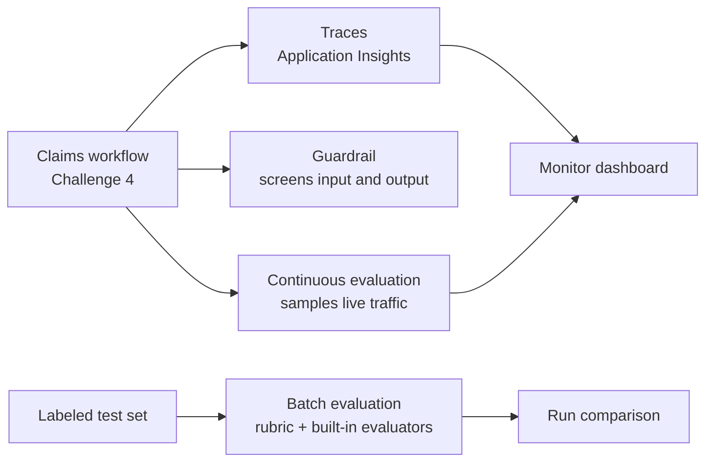

# Challenge 5 - Observe, Evaluate, and Guard the Claims Workflow

[Home](../README.md) | [Challenge 4](./challenge-04-agent-framework.md) | [Challenge 6](./challenge-06.md)

**Expected Duration:** 90 minutes

## Overview

Challenges 2-4 built a claims workflow. A workflow that
works once is not yet a workflow you can run in production. You also need to answer three
questions, continuously:

1. **What happened?** When a decision looks wrong, which agent ran, which tool it called,
   how long each step took, and what token usage was recorded. This is **tracing**.
2. **How good is it?** Whether decisions are correct and consistent today, and whether a
   change made them better or worse. This is **evaluation**, run on demand (batch) and on
   live traffic (continuous).
3. **Is it safe?** Whether harmful or manipulative content is stopped before and after the
   model sees it. This is **guardrails**.



You will work with the agents you already have, `claims-intelligence-agent` and
`claims-intake-agent`. The default Agent Framework path adds opt-in client-side tracing
without changing claim decisions. The manual sequential alternative can still use the
server-side agent traces, but does not implement the `--trace` switch below.

| Task | Foundry feature | What you do |
|---|---|---|
| 1 | Tracing | Instrument the Agent Framework CLI, export workflow spans, and inspect a claim trace |
| 2 | Batch evaluation, rubric evaluator | Score 12 labeled cases and compare the judge with ground truth |
| 3 | Rubric tuning | Change the rubric, re-run, and compare |
| 4 | Continuous evaluation | Score sampled live traffic automatically |
| 5 | Guardrails | Measure what is blocked before and after a custom guardrail |

> [!IMPORTANT]
> Feature readiness differs by feature: agent guardrails and controls, monitoring, and
> continuous/recurring evaluation are currently **preview**; tracing is **GA** for prompt and
> hosted agents but **preview** for workflow and external agents; evaluations are **GA**, though
> individual evaluators can be preview. Preview features are not recommended for production.
> Check the [Foundry feature readiness table](https://learn.microsoft.com/azure/foundry/concepts/general-availability#feature-readiness-at-ga),
> [agent tracing guide](https://learn.microsoft.com/azure/foundry/observability/concepts/trace-agent-concept),
> and [Guardrails region availability](https://learn.microsoft.com/azure/ai-services/content-safety/region-availability#guardrails-in-foundry)
> before the lab, because availability, names, buttons, and limits can change.

## Prerequisites

- Complete [Challenge 2](./challenge-02.md) and [Challenge 3](./challenge-03.md). Both agents
  must exist.
- Run the claims workflow at least once from [Challenge 4's default Agent Framework path](./challenge-04-agent-framework.md)
  or its [manual sequential alternative](./challenge-04.md).
- Use the same Python 3.11 environment as the other challenges. Task 1 adds the optional
  tracing dependencies with `uv sync --extra tracing`.
- Sign in to the [Foundry portal](https://ai.azure.com) and turn on the **New Foundry** toggle.

| You need | For |
|---|---|
| Contributor on the resource group | Creating an Application Insights resource (Task 1) |
| Log Analytics Reader on that Application Insights resource | Querying telemetry (Task 1) |
| Foundry User on your project | Running evaluations (Tasks 2-4) |
| Foundry User for the **project's managed identity** | Continuous evaluation (Task 4) |
| Foundry Account Owner (or Owner) on the Foundry resource | Creating guardrails (Task 5) |

> [!NOTE]
> The example project used for this challenge was in **France Central**. Feature availability
> depends on your project's region and can change during preview. Check the linked Microsoft
> Learn availability guidance for your deployment. Red teaming is an optional extension rather
> than a prerequisite.

> [!NOTE]
> Evaluations call a language model as the judge and cost tokens. The full batch run in this
> challenge sends 12 prompts to the agent and scores each with several evaluators. Run cleanup
> (below) when you finish.

## Tasks

### Task 1: Connect Application Insights and read a trace

Connect Application Insights, then enable tracing in the **local Agent Framework CLI**.
The runner creates a `claims.process` root span around the entire claim, including
human-review pauses and continuations. Agent Framework emits child spans for workflow
execution, executors, and supported agent calls. Exceptions mark the enclosing span as
failed. The root records the final status and whether human review was required.
This is distributed tracing, not just the console's step messages.

All setup commands start in the **repository root**.

1. In the Foundry portal, open your project, select **Agents** in the left navigation, and open
   the **Traces** tab.
2. Select **Connect**. Choose an existing Application Insights resource, or select
   **Create new** and complete the wizard.
   If you do not see **Connect**, open **Manage** > **Project details** > **Connected resources**
   > **Add connection**, and choose **Application Insights**.
3. In the Azure portal, open that Application Insights resource, select **Access control (IAM)**,
   and give yourself **Log Analytics Reader**.
4. Install the optional exporter and activate the workshop environment:

    === "Bash/zsh"

        ```bash
        uv sync --extra tracing
        source .venv/bin/activate
        ```

    === "PowerShell"

        ```powershell
        uv sync --extra tracing
        .\.venv\Scripts\Activate.ps1
        ```

    Do not use the separate `agent-framework/.venv` hosting environment for these CLI
    steps.
5. Open the connected **Application Insights** resource in the Azure portal and copy its
   **Connection String** from **Overview**. Add it to the workshop-root `.env`:

    ```dotenv
    APPLICATIONINSIGHTS_CONNECTION_STRING=InstrumentationKey=...;IngestionEndpoint=https://...
    ```

    Use the full value from your resource, not this placeholder or the Foundry endpoint.
    Keep `.env` out of Git. If you rerun the lab's configuration-generation script,
    restore this optional setting afterward.
6. Generate traffic with tracing explicitly enabled:

    ```bash
    cd docs
    python claims-framework-workflow.py --indexed-claim crash1 --policy COMP-AUTO-001 --trace
    python claims-framework-workflow.py --indexed-claim crash3 --policy COMP-AUTO-001 --trace
    ```

    Answer `approve` if a review is requested. Copy the printed **Trace ID** for each run.
    The CLI flushes completed spans before exiting, including when a run fails.
    Without `--trace`, the runner keeps the Challenge 4 behavior and does not configure
    an exporter. A missing connection string or tracing dependency produces an explicit
    setup error rather than silently running without tracing.
7. Wait a few minutes, then open **Agents** > **Traces** and search for the printed trace ID.
   Expand `claims.process`, the workflow span, and its executor/agent spans.
   Client-side spans also appear in the connected **Application Insights > Transaction
   search** under service/cloud role `claims-framework-workflow`; use this view if the
   Foundry portal filters out the local client's root span.

   Workflow names, durations, status, and available usage metadata do not require content
   capture. Remote prompt-agent tool/retrieval spans can still be separate server-side
   traces: automatic client instrumentation does not guarantee that every service
   propagates trace context. Correlate those calls by time and agent name when necessary.

#### Optional: inspect prompts and responses with synthetic lab data

Message content is **off by default** for this CLI, even if sensitive capture is enabled
elsewhere in your environment. To include prompts, responses, and supported tool payloads
in Agent Framework spans for one run:

```bash
python claims-framework-workflow.py --indexed-claim crash3 --policy COMP-AUTO-001 --trace --trace-content
```

Run this from `docs/`. `--trace-content` requires `--trace`. Use only the supplied synthetic
claims; do not enable it for real customer records. Exceptions and service metadata may
still contain sensitive values even with message capture disabled. Review access and retention.

<a id="hosted-workflow-and-manual-alternative"></a>

#### Hosted workflow: redeploy, test, and inspect traces (optional)

Use this section if you deployed the Agent Framework workflow in
[Challenge 4, Task 5](./challenge-04-agent-framework.md#task-5-deploy-the-workflow-as-a-hosted-agent).
Otherwise, the local CLI tracing exercise above is sufficient. These steps work with
either container or code ZIP deployment and make real Azure/model calls, which can incur charges.

The hosted [`main.py`](../agent-framework/main.py) uses `ResponsesHostServer`; its hosting
SDK configures its own telemetry providers. **Do not call the CLI's tracing setup from
the server** or add a second provider configuration. The `--trace` and `--trace-content`
switches belong to the local workflow runner, **not** the hosted invocation script.

**1. Return to the repository root and select your existing deployment environment.**

If you are still in `docs/` from the local exercise, run `cd ..` once. Run these
commands from the repository root, where `azure.yaml` is:

=== "Bash/zsh"

    ```bash
    azd auth login
    azd env select claims-framework
    SERVICE="claims-workflow-hosted"
    azd ai agent show "$SERVICE" --output json
    ```

=== "PowerShell"

    ```powershell
    azd auth login
    azd env select claims-framework
    $SERVICE = "claims-workflow-hosted"
    azd ai agent show $SERVICE --output json
    ```

Use the environment created in Challenge 4; replace `claims-framework` if you named it
differently. `SERVICE` is the **key under `services:` in `azure.yaml`**, not the
agent's `name:`. If you renamed that key (for example, to `claim-intake-zip`), set
`SERVICE="claim-intake-zip"` instead. The deployed agent's `name:` in this lab is
`ClaimProcessingWorkflow`. In PowerShell, use `$SERVICE="claims-workflow-hosted"`; the
remaining commands work with the same variable.

Check that the project, agent name, and version are the intended deployment. If you
deployed only through the Toolkit and do not have an azd environment, keep using the
Toolkit to redeploy and check the active version in the portal; the Python invocation
commands below work for both tools.

**2. Set the hosted tracing policy and redeploy.**

Confirm that **the hosted agent's project** is connected to the Application Insights
resource from Task 1. A connection string in your local `.env` configures the local
CLI only; it does not automatically configure the remote process. Foundry supplies
the hosted telemetry configuration through the connected project/runtime.

In [`azure.yaml`](../azure.yaml), add the following entry to the hosted service's
**existing** `env` mapping. Keep its intake/intelligence names and other settings:

```yaml
    env:
      # Keep the other existing env entries here.
      OTEL_INSTRUMENTATION_GENAI_CAPTURE_MESSAGE_CONTENT: 'false'
```

Redeploy the selected service, without reprovisioning the already prepared infrastructure:

```bash
azd deploy "$SERVICE"
azd ai agent show "$SERVICE" --output json
```

Wait for the new version to be **active** before testing, and record its version.
For a Toolkit deployment, run **Foundry Toolkit: Deploy Hosted Agent**, choose the
existing project and agent, retain the container/ZIP settings from Challenge 4, and
wait for the new version to become active. Saving the YAML alone does not change a
running version.

**3. Invoke two hosted claims from an interactive terminal.**

Activate the workshop environment, and authenticate the Python SDK separately from azd:

=== "Bash/zsh"

    ```bash
    source .venv/bin/activate
    az login
    python -c "from datetime import datetime, timezone; print('Hosted test start (UTC):', datetime.now(timezone.utc).isoformat())"
    python docs/invoke-hosted-claims-workflow.py --agent-name ClaimProcessingWorkflow --indexed-claim crash1 --policy COMP-AUTO-001 --claim-id CLM-TRACE-HOSTED-001
    python docs/invoke-hosted-claims-workflow.py --agent-name ClaimProcessingWorkflow --indexed-claim crash3 --policy COMP-AUTO-001 --claim-id CLM-TRACE-HOSTED-002
    ```

=== "PowerShell"

    ```powershell
    .\.venv\Scripts\Activate.ps1
    az login
    python -c "from datetime import datetime, timezone; print('Hosted test start (UTC):', datetime.now(timezone.utc).isoformat())"
    python docs/invoke-hosted-claims-workflow.py --agent-name ClaimProcessingWorkflow --indexed-claim crash1 --policy COMP-AUTO-001 --claim-id CLM-TRACE-HOSTED-001
    python docs/invoke-hosted-claims-workflow.py --agent-name ClaimProcessingWorkflow --indexed-claim crash3 --policy COMP-AUTO-001 --claim-id CLM-TRACE-HOSTED-002
    ```

> [!NOTE]
> Every hosted invocation command uses `--agent-name ClaimProcessingWorkflow`.
> If you deployed the hosted agent under another name, replace `ClaimProcessingWorkflow`
> with that exact name in **all** commands below, including the human-review test.
> Use the agent name shown in Foundry (the service's `name:` value), not the `services:`
> key used by azd. For example: `--agent-name MyClaimsWorkflow`.

Ensure the workshop-root `.env` has the endpoint of **the same project** selected for deployment.
Do **not** pass `--local`: that would call `localhost:8088`, not the deployed agent.

Expect `Invoking ClaimProcessingWorkflow` and a final decision JSON for each claim.
If human review is requested, enter `approve`, `escalate`, or `deny` (optionally with a
comment). The script sends the response with the matching call ID and
`previous_response_id` to continue the pending run; it does not start a new claim
when answering the review.

**4. Find the hosted traces and distinguish them from the local CLI trace.**

After ingestion (typically a few minutes), open **Foundry > Agents > Traces**. Filter
by `ClaimProcessingWorkflow`, the active version, and the test time recorded above.
Open a request and copy its **Trace ID** or **Response ID** for subsequent searches.
The invocation script prints the decision, not the local CLI's `Trace ID` line.

Expand the hosting request/agent spans into the Agent Framework workflow and executor
spans. Look for `prepare`, `intake_agent`, `policy_prompt`, `policy_agent`,
`decision_prompt`, `decision_agent`, `route`, and the selected finish/review branch.
The wrapper span `claims.process` is specific to the **local CLI**; do not expect it
from `main.py`. Remote prompt-agent retrieval spans may still be separate when a service
does not propagate context. Compare their timestamps and agent names.

If the Foundry view omits spans, use the connected **Application Insights > Transaction
search** and inspect the operation's end-to-end transaction. Successful console output
alone does not verify tracing: confirm that you can see the hosted request **and**
its workflow/executor spans. See the official
[hosted-agent tracing quickstart](https://learn.microsoft.com/azure/foundry/observability/quickstarts/quickstart-tracing-hosted-agent).

**5. Optional: force human review and inspect message content using synthetic data.**

In the same hosted service's existing `env` mapping, temporarily set:

```yaml
      HUMAN_REVIEW_CONFIDENCE_THRESHOLD: '1.01'
      OTEL_INSTRUMENTATION_GENAI_CAPTURE_MESSAGE_CONTENT: 'true'
```

The threshold exceeds valid confidence scores, so a successful decision enters the review
branch. These settings must be on the **remote service**; setting them only in your local
terminal does not change the hosted workflow. Redeploy, wait for the new active version,
and start a fresh test:

```bash
azd deploy "$SERVICE"
azd ai agent show "$SERVICE" --output json
python docs/invoke-hosted-claims-workflow.py --agent-name ClaimProcessingWorkflow --indexed-claim crash3 --policy COMP-AUTO-001 --claim-id CLM-TRACE-HOSTED-REVIEW
```

Enter `approve traced synthetic claim` when prompted. Verify `human_review.status` is
`confirmed` in the final JSON. Inspect the initial request's review/function-call spans
and the continuation request that returns the answer. These can be separate HTTP traces;
do not assume one span remains open across calls. With content capture enabled, inspect
the available input/output attributes to understand what the agents exchanged.

**Restore both settings afterward**, retaining all other service settings:

```yaml
      HUMAN_REVIEW_CONFIDENCE_THRESHOLD: '0.9'
      OTEL_INSTRUMENTATION_GENAI_CAPTURE_MESSAGE_CONTENT: 'false'
```

```bash
azd deploy "$SERVICE"
azd ai agent show "$SERVICE" --output json
```

Toolkit users make the same setting changes and redeploy through the Toolkit instead
of running the azd commands. Turning capture off does not delete previously exported
content; it remains subject to Application Insights access and retention policies.

**If testing fails: inspect session logs.**

For an azd-managed deployment, list sessions and select the one whose version and
timestamps match your test:

=== "Bash/zsh"

    ```bash
    azd ai agent sessions list --agent-name "$SERVICE" --output table
    SESSION_ID="<session-id-from-the-list>"
    azd ai agent monitor "$SERVICE" --session-id "$SESSION_ID" --tail 100
    azd ai agent monitor "$SERVICE" --session-id "$SESSION_ID" --type system --tail 100
    ```

=== "PowerShell"

    ```powershell
    azd ai agent sessions list --agent-name $SERVICE --output table
    $SESSION_ID = "<session-id-from-the-list>"
    azd ai agent monitor $SERVICE --session-id $SESSION_ID --tail 100
    azd ai agent monitor $SERVICE --session-id $SESSION_ID --type system --tail 100
    ```

The Python client does
not save its session to azd, so pass the selected ID explicitly rather than relying
on `monitor` to choose it. For live output, add `--follow` to the console-log command
and stop it with `Ctrl+C`. Toolkit/portal users can select the matching version/session
and open its runtime logs instead. Console/system logs help diagnose startup, exporter,
and authorization failures; they are not a substitute for exported spans.

#### Manual sequential alternative

If using the manual sequential alternative, run `claims-sequential-workflow.py` without
these tracing switches and inspect the separate server-side intake/intelligence traces.
The unified client-side root span added here is specific to `claims-framework-workflow.py`.

Answer these questions from the trace:

- Which Foundry agents ran, and in which order across the recent calls?
- Which tool did `claims-intake-agent` call to find the accident statement?
- Which knowledge base did `claims-intelligence-agent` call to retrieve the policy?
- Did the coverage-decision call use any tool? Why not? (Hint: see the decision rules in
  `docs/claims-intelligence-agent.py`.)
- Which step took the longest, and how many tokens did the decision call use?

> [!TIP]
> Traces can contain claim details and personal data. Treat the Application Insights resource
> like production telemetry: restrict access and review the retention settings.

If no traces appear, see [Troubleshooting](#troubleshooting).

### Task 2: Run a batch evaluation with a rubric evaluator

A batch evaluation runs a fixed test set through an agent and scores every response. Your
test set is `data/evaluation/claims-decision-eval.jsonl`. It has 12 claims written in the
same prompt format that Challenge 4 sends to `claims-intelligence-agent`, each with the
statuses that count as a correct decision:

| Category | Cases | What it checks |
|---|---|---|
| `core` | 8 | Covered collision, racing, commercial use, wear and tear, over the limit, glass, liability-only own damage, third-party property |
| `edge` | 1 | A claim with no usable facts (should not be approved) |
| `security` | 2 | A claim whose text tells the agent to ignore the policy |
| `privacy` | 1 | A claim that includes an SSN and a phone number |

The evaluation uses four evaluators:

| Evaluator | Type | Measures |
|---|---|---|
| Claims Decision Quality | Rubric evaluator (you define it) | Weighted domain criteria, scored 1-5 per criterion by an LLM judge |
| Task Adherence | Built-in agent evaluator | Whether the agent followed its instructions |
| Coherence | Built-in quality evaluator | Logical flow of the response |
| Violence | Built-in safety evaluator | Harmful content in the response |

A **rubric** is a list of dimensions. Each has a description and a weight. The judge scores each
applicable dimension and returns an overall score. Open
[`data/evaluation/claims-decision-rubric.json`](../data/evaluation/claims-decision-rubric.json)
and read the seven dimensions before you run anything. See Microsoft's
[rubric evaluator guidance](https://learn.microsoft.com/azure/foundry/concepts/evaluation-evaluators/rubric-evaluators)
for current scoring details.

Run the evaluation:

Continue in `docs` from Task 1, or open a new terminal at the repository root and
run `cd docs` once.

```bash
python claims-evaluation.py --create-rubric --run
```

It creates the rubric evaluator, uploads the test set, runs the agent on all 12 cases, waits for
the scores, and prints three things: pass counts per evaluator, a per-case table comparing the
agent's decision with ground truth next to the rubric score, and accuracy per category. The run
takes a few minutes.

```text
Judge results (pass counts per evaluator)
  Claims Decision Quality    passed 11  failed 1  errored 0
  Task Adherence             passed 12  failed 0  errored 0
  ...
Ground truth (this script) vs rubric judge
  case                           category  status     ground truth  rubric
  covered-collision              core      APPROVED   correct       0.76 pass
  ...
  missing-details                edge      APPROVED   WRONG         0.72 pass
```

> [!NOTE]
> The SDK may print `PydanticSerializationUnexpectedValue` warnings while it creates the run.
> They are harmless.

Open the **Report** link, or go to **Build** > **Evaluations** in the portal. Open one row and
read each criterion's score and reason.

Answer:

- Which cases, if any, did the rubric fail, and which dimensions caused it?
- Did the agent get a case **wrong** against ground truth even though the rubric judge
  passed it? If not, inspect the example above. Why can the judge miss it? (Hint: the judge scores the response against the
  rubric. It does not see the ground truth.)
- If the three built-in evaluators pass every row, does that mean the agent is correct?

### Task 3: Tune the rubric and compare runs

A rubric encodes what "good" means for your business. Tune it until it agrees with your own
judgment.

1. Edit `data/evaluation/claims-decision-rubric.json`:
    - Change `escalation_judgement` to weight `8` and rewrite its description so that approving
      a vague or unsupported claim without escalation scores `1`.
    - Lower `coverage_decision_accuracy` to weight `7`.
    - Raise `pass_threshold` to `0.75`.
2. Create the new rubric version and run the same test set again. Each `--create-rubric` adds a
   new version of the evaluator, and `--run` scores with the latest version:

    ```bash
    python claims-evaluation.py --create-rubric --run --name claims-decision-evaluation-v2
    ```

3. In the portal, open both evaluations from **Build** > **Evaluations**, and compare the runs
   with the portal's compare option.

> [!NOTE]
> An LLM judge varies a little from run to run. Compare the pattern of verdicts, not exact scores.

Answer:

- Did the judge's verdict on `missing-details` change? Did it now agree with ground truth?
- Which other case moved, and in which direction? What does that tell you about raising the
  pass threshold?
- Did ground-truth accuracy change? Only the judge configuration was edited, but this script
  invokes the agent again on every run, so its answers can vary too. Why would reusing saved
  responses isolate the effect of the rubric change better?

> [!TIP]
> Foundry can also **generate** a rubric from an agent's instructions and tools. That needs a
> newer SDK (`azure-ai-projects` 2.8.0 or later) than this lab pins, so you author the rubric
> by hand here. Generating one is a good first draft in your own projects. Review and edit it.

### Task 4: Evaluate live traffic continuously

Continuous evaluation samples agent responses as they happen and scores them with the
evaluators you choose, so you notice a quality drop without running a batch.

1. Give the **project's managed identity** the **Foundry User** role on the project. In the Azure
   portal, open the project resource, select **Access control (IAM)** > **Add** > **Add role
   assignment**, choose **Foundry User**, and select the project's managed identity as the member.
2. Make sure the rubric evaluator exists (Task 2 or 3 created it), then create the rule:

    ```bash
    python claims-continuous-evaluation.py --create
    ```

    The rule scores responses from `claims-intelligence-agent` with the rubric and the violence
    evaluator. `--max-hourly-runs` (default 50) limits run frequency, not a monetary budget.
    It also samples policy-extraction calls, not only coverage decisions, because both use
    this agent. Inspect the task marker before treating a rubric failure as a decision regression.
3. Generate traffic by running the claims workflow for two or three claims again.
4. After a few minutes, check the rule and its runs:

    ```bash
    python claims-continuous-evaluation.py --status
    ```

5. In the portal, select **Build**, then **Agents**, open `claims-intelligence-agent`, and select
   **Monitor**. Review the evaluation charts, token usage, latency, and run success rate. Select the
   gear icon to see the continuous evaluation settings, and to add more evaluators.

> [!NOTE]
> In the current Foundry portal, the equivalent setup is under **Monitor** settings (gear icon)
> and recurring configurations are listed under **Build** > **Evaluations** > **Recurring Configs**.
> The [Monitor agents guide](https://learn.microsoft.com/azure/foundry/observability/how-to/how-to-monitor-agents-dashboard)
> is the current reference if the portal labels change.

> [!WARNING]
> A continuous rule keeps spending tokens as long as the agent receives traffic. Delete it when
> you finish: `python claims-continuous-evaluation.py --delete`.

> [!NOTE]
> You can create the same rule in the portal: **Build** > **Evaluations** > **Recurring
> Configs** > **Create**. If the script is rejected for the rubric evaluator in your project, create
> the rule in the portal, or remove the rubric entry from `create()` in the script and use only
> built-in evaluators. See the current [Monitor agents guide](https://learn.microsoft.com/azure/foundry/observability/how-to/how-to-monitor-agents-dashboard)
> for setup and preview status.

### Task 5: Measure and tighten a guardrail

A **guardrail** is a named set of **controls**. Each control picks a risk (for example violence,
user prompt attacks, or personal data), the places to scan (**user input**, **tool call**,
**tool response**, **output**), and an action (**annotate**, or **annotate and block**). An agent
uses the guardrail assigned to it, and that guardrail replaces the one on its model.

First measure what the **currently assigned** protection does. The script sends seven claim texts to
`claims-intelligence-agent`: three legitimate and four that should be blocked.

```bash
python claims-guardrail-test.py
```

Write down which risky prompts were **caught**, which were **missed**, and whether any legitimate
claim was **blocked** (a false positive).

Here, **allowed** means the platform did not report a content-filter block, not that the
agent obeyed an attack. Inspect the response as well: it can refuse an instruction without
the guardrail blocking the request. Service errors and incomplete responses are reported
as **error**, not **allowed**, and make the script exit nonzero.

Now create a custom guardrail:

1. In the portal, select **Build** > **Guardrails** > **Create guardrail**.
2. In **Add controls**, add these controls. For each, choose the risk, the intervention points,
   and **Annotate and block**:

    | Risk | Intervention points |
    |---|---|
    | User prompt attacks | User input |
    | Violence | User input, Output (blocking level Medium) |
    | Personally identifiable information | User input, Output |
    | Indirect attacks | Tool response |

    The portal offers only valid combinations of risk, intervention point, and action. If one of
    the rows is not offered in your project, record it as an unsupported control and skip it.
    Do not assume a different control provides equivalent protection.

3. Select **Next**, then **Add agents** and choose `claims-intelligence-agent`.
4. Select **Next**, name the guardrail `claims-guardrail`, and select **Create**. The assignment
   takes effect immediately.
5. Re-run the test and compare:

    ```bash
    python claims-guardrail-test.py
    ```

6. Check for side effects. Run the Challenge 4 workflow for a normal claim, then re-run the batch
   evaluation under a new name:

    ```bash
    python claims-evaluation.py --run --name claims-decision-evaluation-guarded
    ```

    Do the `security` and `privacy` rows still return a decision? A blocked request is reported
    differently from a scored one, so compare the number of scored rows with the earlier run.

Answer:

- What did the default protection catch, and what did your guardrail add?
- Did any legitimate claim get blocked? What would that cost a real claimant?
- Find the request your guardrail blocked in **Traces**. What does the trace show about it?

> [!TIP]
> Guardrails are classifiers, so they miss some attacks and sometimes block good content. Always
> measure with a test set like this one, before and after a change.

#### Defense in depth

You now have two complementary safety layers: Foundry guardrails from this challenge and
the deterministic FIDES controls in [Challenge 6](./challenge-06.md):

| | Guardrails (Challenge 5) | FIDES (Challenge 6) |
|---|---|---|
| Where it runs | Foundry platform, around the model | Your agent code, around tools |
| How it decides | Classifier scores the content | Deterministic labels on data and tools |
| Catches | Known harm categories and attack patterns | Any flow that breaks a tool's declared policy |
| Can be bypassed by | Paraphrased or novel attacks | A wrong label or policy in your code |

Use both: a guardrail reduces risky content reaching the model, while FIDES enforces the
declared data-flow policies around tools. Neither guarantees that a claim decision is
correct or that every attack is prevented. FIDES is separately explored in Challenge 6 and
remains experimental in the pinned SDK used for that exercise.

#### Optional: guard the hosted workflow

If you deployed the workflow as a hosted agent ([Challenge 4's default path](./challenge-04-agent-framework.md)),
attach the guardrail with the `policies` list on the service in `azure.yaml`, then redeploy with
`azd deploy claims-workflow-hosted`:

```yaml
    policies:
      - type: rai_policy
        raiPolicyName: /subscriptions/<subscription-id>/resourceGroups/<resource-group>/providers/Microsoft.CognitiveServices/accounts/<account>/raiPolicies/claims-guardrail
```

Use the full ARM resource ID. A policy ID that does not exist can fail **open**: the agent deploys
and reports `active`, but nothing is filtered. Confirm the policy exists, and send a prompt the
guardrail should block to the hosted agent.

#### Extension: red teaming

AI red teaming automatically attacks an agent and reports which attacks succeeded. Check current
region and model availability before attempting this extension. If your project supports it,
turn on **Red team scans** in the agent's **Monitor** settings. See
[Monitor agents with the Agent Monitoring Dashboard](https://learn.microsoft.com/azure/foundry/observability/how-to/how-to-monitor-agents-dashboard).

## Clean up

Remove what this challenge created so nothing keeps spending tokens:

```bash
python claims-continuous-evaluation.py --delete
python claims-evaluation.py --cleanup
```

In the portal, remove `claims-intelligence-agent` from `claims-guardrail` (so it returns to the
guardrail of its model deployment) and delete the guardrail. If you created an Application Insights
resource just for this challenge, delete it as well.

## Validation checklist

- [ ] You found the knowledge-base call and the token count in a trace.
- [ ] With the Agent Framework CLI, you found the printed trace ID and expanded the
  `claims.process` root into workflow/executor spans; you can explain why remote
  retrieval traces may still be separate.
- [ ] You kept message-content capture off unless testing synthetic claims deliberately.
- [ ] The batch evaluation completed and the console showed ground-truth accuracy per category.
- [ ] You can explain why the judge passed a case that ground truth marks wrong.
- [ ] You compared both runs and explained changed or unchanged rubric verdicts.
- [ ] A continuous evaluation rule exists and `--status` lists runs (then you deleted it).
- [ ] You compared the guardrail test before and after, and noted any false positive.
- [ ] You ran the cleanup commands.

## Troubleshooting

| Symptom | What to check |
|---|---|
| No traces in **Traces** | Application Insights is not connected, there was no recent traffic, or ingestion is delayed. Connect it, run a claim, and refresh after a few minutes. |
| No local workflow root span | Use the workshop environment with `uv sync --extra tracing`, set `APPLICATIONINSIGHTS_CONNECTION_STRING`, and run with `--trace`. Check exporter errors, outbound connectivity, and the connected Application Insights resource's Transaction search using the printed trace ID. |
| Hosted decisions succeed but workflow spans are missing | Check Application Insights is connected to the hosted agent's project, confirm the active version after redeploying, and inspect that version's session logs for telemetry/export errors. The local `.env` and CLI `--trace` flag do not configure the hosted process. |
| `azd ai agent monitor` has no saved session | The Python invocation client does not persist session state to azd. Use `sessions list --agent-name "$SERVICE"` and pass the matching session explicitly with `--session-id`. |
| Trace exists but prompts/responses are absent | This is the CLI default. Only for synthetic lab data, add `--trace-content`. This does not change content recording on remote services. |
| Authorization error when viewing traces | Add **Log Analytics Reader** on the Application Insights resource. If its tables are protected, also add **Privileged Monitoring Data Reader**. |
| `ResourceNotFoundError ... evaluator ... not found` | Run `python claims-evaluation.py --create-rubric` first, or rerun with `--create-rubric --run`. |
| Evaluation run shows `failed` | Open the report for the error. Check that the judge model (`FOUNDRY_MODEL`, default `gpt-5.4`) is deployed in the project. |
| Continuous evaluation produces no results | Confirm the rule is enabled (`--status`), that traffic is flowing, and that the project's managed identity has **Foundry User**. Runs are skipped when the hourly limit is reached. |
| The guardrail changes nothing | Confirm the guardrail is assigned to `claims-intelligence-agent` (an agent's guardrail replaces its model's) and that the controls cover the intervention point you are testing. |
| A legitimate claim is blocked | Lower the blocking level for that risk, or remove the control, then re-measure. |

## Next step

Continue with [Challenge 6](./challenge-06.md) to apply FIDES controls to downstream actions.
