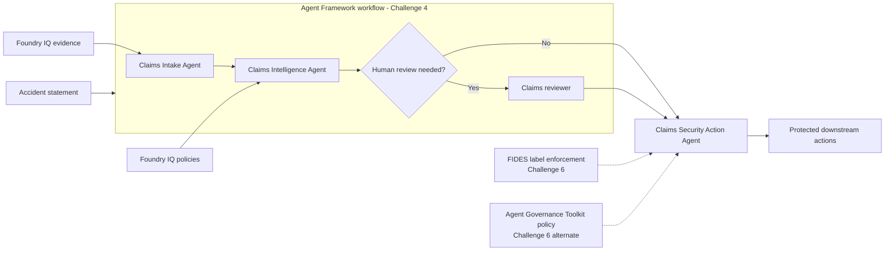
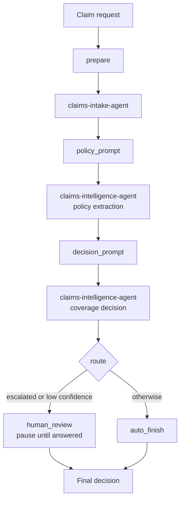
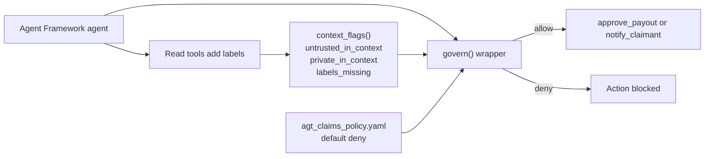

# Build a claims-processing workflow, one challenge at a time

Welcome to the ClaimSight Claims MicroHack. You'll build and explore a claims
workflow that reads accident statements, retrieves policy evidence, coordinates
specialist agents, routes uncertain decisions to human review, and protects sensitive
actions.

The workshop is designed to be completed in order. You can choose **Bash/zsh** or
**PowerShell** in the command tabs; choosing a tab updates matching command tabs
throughout the site.

## Your path through the workshop

1. **Get your environment ready.** Confirm the lab accounts and Azure resources, open
   the Codespace, and configure your local environment in
   [Challenge 1: Prepare the Environment](challenges/challenge-01.md).
2. **Build the claims workflow.** Work through Challenges 2–4 to extract claim
   details, retrieve policy evidence, and compose the agents into a workflow.
3. **Make it observable and secure.** Trace and evaluate decisions in
   [Challenge 5](challenges/challenge-05.md), then test deterministic security
   controls in [Challenge 6](challenges/challenge-06.md).
4. **Understand the design.** Review the architecture diagram below before you start.

!!! important "Before you begin"

    This is a hands-on lab. You need the assigned lab account, a provisioned Azure
    environment, and the repository's **Claims Hack** development container. Start
    with Challenge 1; it explains the prerequisites and setup.

## Choose your first challenge

| Challenge | What you'll do | Time |
| --- | --- | ---: |
| [1. Prepare the environment](challenges/challenge-01.md) | Verify your lab access, start the Codespace, and configure your tools. | 30 min |
| [2. Build the Claims Intake Agent](challenges/challenge-02.md) | Extract accident statements and find related evidence. | 45 min |
| [3. Build the Claims Intelligence Agent](challenges/challenge-03.md) | Ground coverage decisions in retrieved insurance policies. | 30 min |
| [4. Build the Agent Framework workflow](challenges/challenge-04-agent-framework.md) | Compose the agents and support conditional human review. | 45 min |
| [5. Observe and evaluate](challenges/challenge-05.md) | Trace runs, score decisions, and measure guardrails. | 90 min |
| [6. Harden the claims pipeline](challenges/challenge-06.md) | Defend sensitive actions against prompt injection. | 60 min |

Challenge 4's Agent Framework workflow is the recommended path. The
[sequential workflow](challenges/challenge-04.md) remains available as an
alternative. Challenge 5's optional hosted-agent exercises require a deployment and
may incur Azure charges.

## Where to run commands

Unless a challenge says otherwise, run commands from the **workshop root**: the folder
containing `pyproject.toml`, `azure.yaml`, `docs/`, `challenges/`, and
`agent-framework/`. Some tasks explicitly ask you to change into `docs/` or
`agent-framework/`; follow the directory shown above each command.

Use the [shell selection guide](shells.md) to switch between Bash/zsh and
PowerShell, understand which scripts need Bash, and keep secrets out of command
output and source control.

## Architecture at a glance { #architecture }

The workshop combines specialized Foundry agents, a Microsoft Agent Framework
workflow, grounded retrieval, and deterministic security controls:

### Agent Framework workflow

[Challenge 4](challenges/challenge-04-agent-framework.md) connects the two Foundry
agents with an Agent Framework **workflow**. The workflow is a graph: each node does one
job and each edge says where the result goes next. It reuses `claims-intake-agent` and
`claims-intelligence-agent` instead of creating replacements.

The `route` node sends escalated or low-confidence decisions to a human reviewer, and
the workflow pauses until the reviewer answers. The workflow can run locally or be
deployed as a Foundry hosted agent that exposes the Responses API.

### Security enforcement

Challenge 6 protects the same two downstream actions on either path:

- `approve_payout` must not run while claimant-written text is in the agent's context.
- `notify_claimant` must not run while private policyholder data is in the agent's context.

| | [FIDES](challenges/challenge-06.md) | [Agent Governance Toolkit (AGT)](challenges/challenge-06-agt.md) |
| --- | --- | --- |
| How it decides | Labels data by trust and sensitivity, and the label travels with the data through the run. | Wraps each action with `govern()`, which evaluates a YAML policy before the action runs. |
| Where it runs | In Agent Framework middleware, configured with `SecureAgentConfig`. | Around the action tools that the Agent Framework agent calls. |
| What blocks an action | A sink rejects data above its label limit. | A deny rule matches the context flags the host computes from the labels. |
| Default | Sinks declare the riskiest data they accept. | `default_action: deny`. |

In the AGT path, the read tools add labels, `context_flags()` turns them into simple
true or false flags, and the policy in `agt_claims_policy.yaml` decides whether the
action body runs:

The workshop instructions are built directly from the challenge files in the
repository, so each guide has a single source of truth. Solution walkthroughs remain
available in the repository but are intentionally not included in this site.
