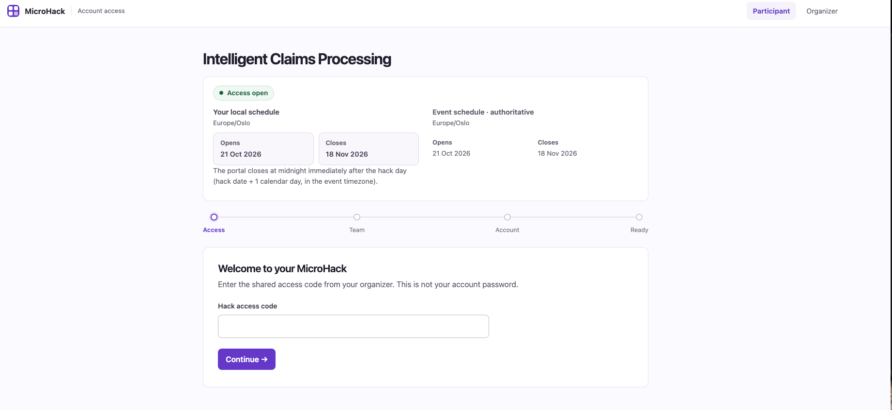

[Home](../../README.md) | [Challenge 01](../../challenges/challenge-01.md) | [Next solution](../challenge-02/solution-02.md)

## Outcome

This solution verifies access to the provisioned Azure and GitHub resources, prepares
the Claims Hack Codespace, creates the local `.env` file, and confirms that all claim
and policy assets are available in Blob Storage.

## Prerequisites

* Sign in at the [Intelligent Claims Processing event page](https://app-mhfb-fc1fed64d4.azurewebsites.net/intelligent-claims-processing)
  with the access code provided by the organizers. This gives you the credentials for
  the EMEA hack portal.
* Receive the assigned Azure and GitHub lab credentials from the Hackbox
* Receive the assigned Azure resource group name
* Use the assigned lab accounts rather than personal or work accounts

The event page asks for the shared hack access code:



## Verify the provisioned resources

Sign in to the [Azure portal](https://portal.azure.com) with **Use another account**.
Open the assigned resource group and confirm that the deployment succeeded and these
resources are present:

* A Microsoft Foundry project
* The `gpt-5.4` and `mistral-document-ai-2512` model deployments
* An Azure AI Search service
* A Storage account

Sign in to [GitHub](https://github.com) with **Use another account**, select **Sign in
with your identity provider**, and open the `microhack` repository in the organization
assigned to the lab account.

## Create the Codespace

On the repository page, select **Code > Codespaces > ... > New with options**. Choose
**Claims Hack** as the dev container configuration and create the Codespace. Wait for
container setup to finish, then open a new integrated terminal.

From the Claims MicroHack directory, verify the Azure CLI, install the pinned Python
dependencies, and activate the environment:

=== "Bash/zsh"

    ```bash
    az --version
    uv sync --frozen
    source .venv/bin/activate
    ```

=== "PowerShell"

    ```powershell
    az --version
    uv sync --frozen
    .\.venv\Scripts\Activate.ps1
    ```

Authenticate with the assigned Azure lab account:

```console
az login --use-device-code
az account show --query "{subscription:name, tenantId:tenantId, user:user.name}" --output table
```

Confirm that the displayed user and subscription belong to the lab. If Azure selected
a different subscription, set the correct one before continuing:

```console
az account set --subscription "<your-subscription-id>"
```

## Create the local configuration

Run the setup script with the resource group name shown in the Hackbox. Use the script for
your shell.

=== "Bash/zsh"

    ```bash
    bash labautomation/get-keys.sh --resource-group "<your-resource-group-name>"
    ```

    This script needs Bash 4 or newer; macOS's built-in Bash 3.2 is too old.

=== "PowerShell"

    ```powershell
    .\labautomation\get-keys.ps1 -ResourceGroup "<your-resource-group-name>"
    ```

    No WSL or Git Bash is needed. Azure CLI must be installed.

A successful run identifies the deployment, Foundry account, Search service, and
Storage account, then reports that `.env` was created with permissions `600`. Verify
the file and required variable names without displaying their secret values:

=== "Bash/zsh"

    ```bash
    stat -c '%a %n' .env
    sed -n 's/^\([A-Z0-9_]*\)=.*/\1/p' .env
    ```

=== "PowerShell"

    ```powershell
    (Get-Item .env).Attributes
    Get-Content .env | ForEach-Object { if ($_ -match '^([A-Z0-9_]+)=') { $Matches[1] } }
    ```

In PowerShell, inspect the file's Windows permissions in File Explorer or with
`Get-Acl .env`; list configured variable names without revealing their values:

```powershell
Get-Content .env | Where-Object { $_ -match '^[A-Z0-9_]+=.*$' } |
  ForEach-Object { ($_ -split '=', 2)[0] }
```

The first command should print `600 .env`. The variable list should include the
Foundry project endpoint and model names, Mistral Document AI settings, Azure AI
Search settings, and the Storage connection string.

> [!IMPORTANT]
> Do not print, share, or commit `.env`. Do not run `labautomation/deploy-lab.ps1`;
> infrastructure deployment is performed by the MicroHack platform.

## Verify the Blob Storage assets

Copy the Storage account name printed by `get-keys.sh`, then count the deployed
assets using the connection string already stored in `.env`:

=== "Bash/zsh"

    ```bash
    STORAGE_ACCOUNT="<storage-account-name>"
    STORAGE_CONNECTION_STRING="$(sed -n 's/^AZURE_STORAGE_CONNECTION_STRING=//p' .env)"

    az storage blob list \
      --connection-string "$STORAGE_CONNECTION_STRING" \
      --container-name claims-data \
      --query "length(@)" \
      --output tsv

    az storage blob list \
      --connection-string "$STORAGE_CONNECTION_STRING" \
      --container-name policies \
      --query "length(@)" \
      --output tsv
    ```

=== "PowerShell"

    ```powershell
    $STORAGE_ACCOUNT = "<storage-account-name>"
    $STORAGE_CONNECTION_STRING = ((Get-Content .env) |
      Where-Object { $_ -match '^AZURE_STORAGE_CONNECTION_STRING=' }) -replace '^[^=]*=', ''

    az storage blob list --connection-string $STORAGE_CONNECTION_STRING --container-name claims-data --query "length(@)" --output tsv
    az storage blob list --connection-string $STORAGE_CONNECTION_STRING --container-name policies --query "length(@)" --output tsv
    ```

The expected counts are:

```text
17
5
```

If either count is lower, upload the supplied assets and repeat both count commands:

```bash
bash labautomation/upload-assets.sh \
	--subscription "<your-subscription-id>" \
	--resource-group "<your-resource-group-name>" \
	--storage-account "$STORAGE_ACCOUNT"
```

PowerShell users can use the equivalent script with the Az PowerShell modules
installed (`Az.Accounts`, `Az.Resources`, and `Az.Storage`) and the lab subscription
selected:

```powershell
./labautomation/upload-assets.ps1 `
  -SubscriptionId "<your-subscription-id>" `
  -ResourceGroupName "<your-resource-group-name>" `
  -StorageAccountName $STORAGE_ACCOUNT
```

The recovery command should finish with:

```text
Asset upload complete and verified: 17 claims, 5 policies.
```

Finally, confirm that the Claims Intake Agent CLI and its installed Python
dependencies load correctly:

```bash
python docs/claims-intake-agent.py --help
```

## Troubleshooting

* If the resource group is missing, check the active user and subscription with
	`az account show`, then sign in again with the assigned account
* If `get-keys.sh` reports an authorization error, confirm that the lab account can
	read deployment outputs and list keys for Foundry, Search, and Storage
* If Blob Storage authentication fails, rerun `get-keys.sh` and confirm that
	`AZURE_STORAGE_CONNECTION_STRING` is listed by the variable-name check
* If **Claims Hack** is not offered, return to the assigned `microhack` repository
	before creating the Codespace
* If Python reports a missing package, rerun `uv sync --frozen` and reactivate
	`.venv`

## Validation checklist

* [ ] The assigned Azure resource group and all four required service types are visible
* [ ] Both required model deployments are present in the Foundry project
* [ ] The assigned GitHub organization and `microhack` repository are accessible
* [ ] The Codespace uses the **Claims Hack** dev container
* [ ] Azure CLI is authenticated to the assigned lab subscription
* [ ] `.env` exists with permissions `600`
* [ ] Blob Storage contains 17 claim assets and 5 policy documents
* [ ] `python docs/claims-intake-agent.py --help` completes successfully

Continue with [Challenge 02](../../challenges/challenge-02.md) and its
[solution](../challenge-02/solution-02.md).
